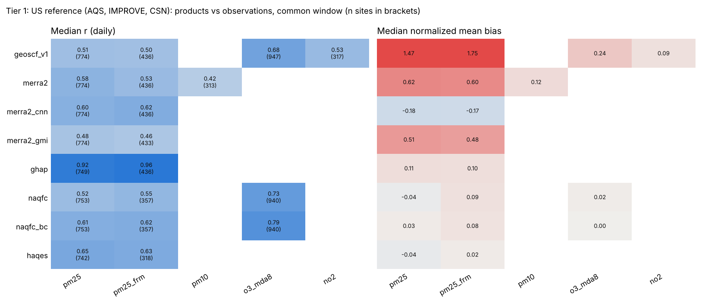
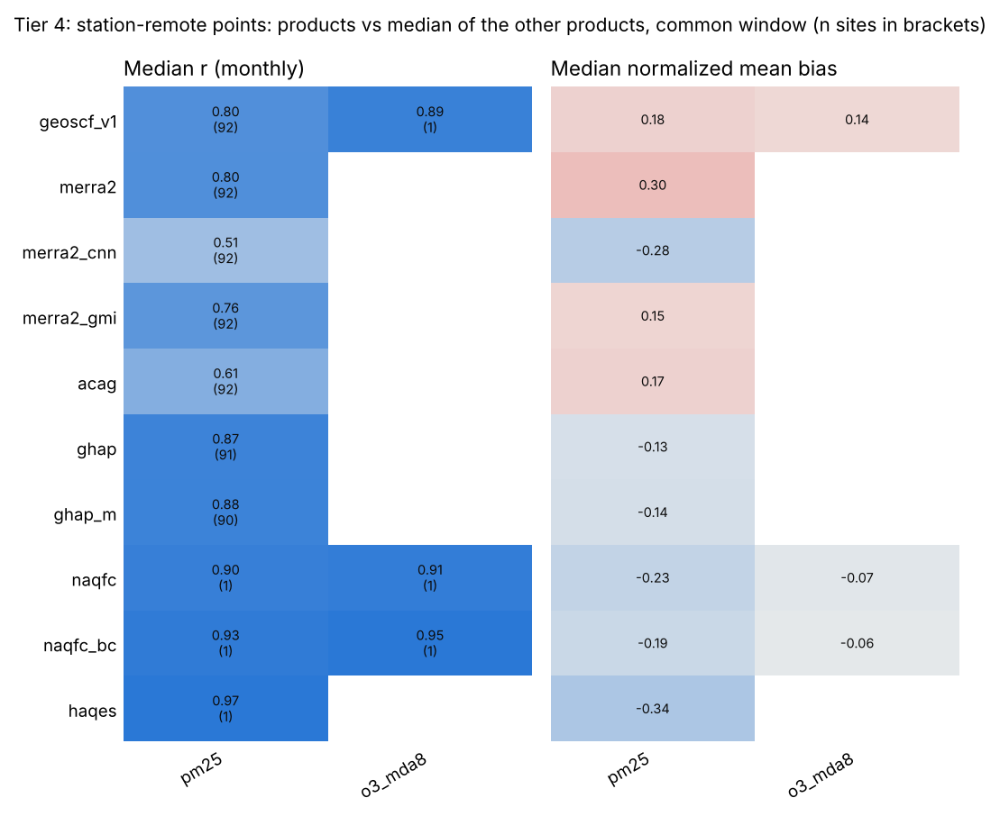

# air-quality-data-comparison

**Question.** How well do gridded near-surface air-quality products reproduce what monitors
measure? The variables are PM2.5, PM10, the main PM2.5 components, O3 and NO2, at hourly,
daily and monthly scales. Does it matter whether a product uses the monitors itself? And how
far do products disagree with each other away from any monitor?

**What was done.**
- **Products.** Point time series were extracted from 13 product streams (11 products) at 2,178 sites:
  - Atmospheric models: GEOS-CF v1 and v2, MERRA-2 aerosols, MERRA-2 GMI, GEOS-FP aerosols, NOAA NAQFC/AQM (raw and bias-corrected), HAQES and HRRR-Smoke.
  - Machine-learning or satellite-calibrated products: the bias-corrected MERRA-2 PM2.5 `MERRA2_CNN_HAQAST_PM25`, ACAG V6 and GHAP.
  - CAMS EAC4 reanalysis and the CAMS global forecast are being added (see [Update 2026-11](#update-2026-11)).
- **Comparison.** Each product was compared with:
  - US reference monitors (EPA AQS/AirNow) and the IMPROVE/CSN filter networks;
  - US embassy monitors and SPARTAN worldwide;
  - 400 government reference monitors in 39 countries outside the US, from OpenAQ;
  - low-cost sensors: Sensor.Community, and AirGradient and AirQo from OpenAQ;
  - 89 station-remote points, where products are scored against each other.
- **Extraction.** Every product is sampled on the 2×2 pixel stencil around each site, giving
  nearest-pixel and bilinear values.
- **Storage.** The series live in per-product Icechunk repositories, quantized and
  pcodec-compressed, in a public S3 bucket (see [Storage](#storage)).
- **Website.** A static site lets you click any site and compare products against the observations.

Site: https://ashiklom.github.io/simon-code-research/air-quality-data-comparison/

## Key results

Unless stated otherwise, numbers are medians across sites. They use daily values, bilinear
interpolation and the common window 2018–2023. The full tables, including the recent window,
Tier 3 and components, are in [`results/key_tables.md`](results/key_tables.md). The other
summaries are in `results/summary_by_{tier,region,network,setting}.csv`, and
`data/results/metrics_all.parquet` (344,349 rows) has every site.



**Tier 1, US reference monitors (774 AQS PM2.5 sites, 947 O3, 317 NO2).** ¹ marks products
that use surface monitors (see [Dependence](#dependence)).

| Product | PM2.5 r | PM2.5 NMB | PM2.5 RMSE (µg m⁻³) | CSI > 35 | AQI category agreement | Monthly PM2.5 r | O3 MDA8 r | O3 MDA8 NMB |
|---|---|---|---|---|---|---|---|---|
| GHAP ¹ (2018–2022) | **0.92** | +11 % | **2.4** | **0.50** | **0.88** | **0.96** | – | – |
| ACAG V6 ¹ (monthly) | – | – | – | – | – | 0.79 | – | – |
| NAQFC bias-corrected ¹ | 0.61 | +3 % | 5.3 | 0.12 | 0.79 | 0.92 | **0.79** | 0 % |
| HAQES ¹ (2022 →) | 0.65 | −4 % | 5.1 | 0.20 | 0.77 | 0.74 | – | – |
| MERRA-2 CNN ¹ | 0.60 | −18 % | 5.3 | 0.00 | 0.77 | 0.64 | – | – |
| NAQFC raw | 0.52 | −4 % | 6.5 | 0.10 | 0.74 | 0.49 | 0.73 | +2 % |
| MERRA-2 | 0.58 | +62 % | 9.3 | 0.14 | 0.58 | 0.70 | – | – |
| MERRA-2 GMI | 0.48 | +51 % | 7.6 | 0.15 | 0.59 | 0.62 | – | – |
| GEOS-CF v1 | 0.51 | +147 % | 18.0 | 0.02 | 0.42 | 0.51 | 0.68 | +24 % |

- **Products trained on monitors score best, but on the same monitors.**
  - **GHAP** reproduces daily PM2.5 at AQS almost perfectly: r 0.92 (0.96 against FRM
    filters), RMSE 2.4 µg m⁻³. It was trained on these sites.
  - At the embassies and SPARTAN, GHAP still leads (r 0.82, NMB +2 %), but many of those
    monitors are in its training set too.
  - **No independent model gets past daily r ≈ 0.6 for PM2.5 at US monitors.** GEOS-CF,
    MERRA-2, GMI and raw NAQFC score r 0.48–0.58.
- **GEOS-CF v1 PM2.5 is ~2.5× too high over the US.**
  - NMB is +147 % at AQS (+175 % against FRM filters) and +211 % at the low-cost sensors.
  - The bias is larger at rural (+166 %) than urban (+138 %) monitors, so it is not a
    point-vs-grid effect.
  - Elsewhere it is mixed: about 0 at the embassies in Africa and the Middle East,
    +41 % in South Asia, +224 % in East Asia.
  - The new OpenAQ reference monitors show the same excess in Europe: +116 % at 240
    sites. GEOS-CF v2 halves it there (+59 %).
- **GEOS-CF v2 fixes most of the PM2.5 bias.** Over their overlap (2025-08..2026-01,
  `results/geoscf_v1_vs_v2.csv`), compared with v1:
  - PM2.5 NMB +28 % against v1's +181 %; RMSE 5.1 against 16.0 µg m⁻³; r 0.62 against 0.59.
  - O3 MDA8 r 0.83 against 0.76.
  - NO2 flips from +27 % to −40 %.
  - Its new PM10 is −46 % low.
  - Components show where the remaining PM2.5 excess comes from: against IMPROVE/CSN,
    nitrate is +153 % and ammonium +355 %, with sulfate +70 % and OM +50 %.
- **The GOCART aerosol products (MERRA-2, GEOS-FP) overestimate US PM2.5 by 30–60 %**
  (MERRA-2 +62 %; GEOS-FP +31 % over the recent window). They assimilate no surface PM.
  - Against filters, the excess is mostly sulfate (MERRA-2 +171 %, GEOS-FP +197 %), sea
    salt (+814 %, +395 %) and fine dust (+204 %, +121 %). MERRA-2 has no nitrate.
  - MERRA-2 GMI adds nitrate (+13 %) but over-predicts ammonium (+239 %), and its PM2.5
    NMB is +51 %.
  - The bias-corrected **MERRA-2 CNN** removes most of the bias (−18 %) and raises r to 0.60.
    It smooths peaks, though: at the median site it never reaches 35 µg m⁻³ when the
    monitor does (CSI 0.00).
- **Ozone: NAQFC is best.**
  - MDA8 r is 0.79 with no bias for bias-corrected NAQFC, and 0.73 (+2 %) raw.
  - GEOS-CF v1 is 0.68 with +24 % bias; it is high at most sites.
  - The ozone exceedance skill at 70 ppb is in `summary_by_tier.csv` (`csi_70`).
- **Smoke days** (AQS days with HRRR-Smoke ≥ 20 µg m⁻³; median 9–15 days per site, 412 sites):
  - HRRR-Smoke's smoke-only PM2.5 matches total PM2.5 well: r 0.59, NMB +1 %.
  - HAQES is the best non-GHAP product for exceedances (r 0.64, CSI 0.59 at 35 µg m⁻³).
  - NAQFC under-predicts smoke (raw −37 %, bias-corrected −24 %). MERRA-2 CNN is −27 %.
  - MERRA-2 (+142 %) and GEOS-CF v1 (+105 %) catch every exceedance but with many false alarms.
- **Embassies and SPARTAN (Tier 2a: 85 embassy and 19 SPARTAN monitors).**
  - Independent models do about as well as in the US: daily r ≈ 0.3–0.5. GEOS-CF v1 is
    0.51 with NMB +13 %; GEOS-CF v2 and GEOS-FP are 0.48 and 0.47, both −3 %.
  - Regional spread is large. GEOS-CF v1 r ranges from 0.30 in the Middle East to 0.71 in
    East Asia. MERRA-2 CNN reaches 0.77 in South Asia.
  - At the four Balkan/Moldovan embassies, most products are far too low: MERRA-2 CNN
    −67 %, GEOS-FP −64 %, MERRA-2 −61 %, GHAP −43 %. GEOS-CF is closer (v1 −13 %, v2
    −24 %). Wintertime heating emissions are the likely gap.
- **OpenAQ reference monitors outside the US (Tier 2b: 400 sites in 39 countries, 273 of
  them in Europe).** These are new in this update.
  - **PM2.5.** The ranking matches the US:
    - GHAP: r 0.91, +3 %. Many of these monitors are in its training set.
    - MERRA-2 CNN: r 0.64, −13 %.
    - GEOS-CF v1: r 0.55, +93 %. GEOS-CF v2: r 0.59, +46 %.
    - GEOS-FP: r 0.43. MERRA-2 and GMI: r 0.30–0.34.
  - **O3 MDA8.** GEOS-CF tracks the day-to-day variation well (v1 r 0.76, v2 0.81; 0.85
    in Europe) but is biased high (+19 %, +30 %). It does poorly at the few South Asian
    and Latin American sites (r 0.1–0.3).
  - **NO2.** GEOS-CF is far below these mostly urban monitors (v1 −40 %, v2 −52 %).
- **Low-cost sensors (Tier 3).**
  - **Sensor.Community** (53 SDS011 sensors scored, 2023–2024). Products look 15–210 %
    too high against them, but most of that is the sensors. At 4 sensors near reference
    monitors, the raw SDS011 reads 14–67 % low, with daily r 0.77–0.96
    (`results/sensor_vs_monitor.csv`).
  - **AirGradient and AirQo from OpenAQ** (106 sensors scored, 2023-11 → 2026-11, as
    published by the provider). Product biases look much smaller here: GEOS-CF v1 +59 %,
    MERRA-2 +15 %, MERRA-2 CNN −20 %.
  - These sensors read high rather than low. At 27 of them within 3 km of a reference
    monitor, they read a median 24 % high, with daily r 0.86.
- **Away from monitors (Tier 4, 89 remote points, monthly).** Products are compared with the
  median of the others.

  

  - GEOS-CF v1 and MERRA-2 follow the ensemble's month-to-month variation best (r 0.79),
    then GMI (0.74).
  - The ML/satellite products diverge most. GHAP is 12 % below the others and ACAG 11 %
    above, with the weakest agreement (r 0.51). MERRA-2 CNN is 33 % below (r 0.62).
  - Products agree on the timing of PM away from stations but disagree by ±10–35 % on its
    level.
- **Bilinear vs nearest pixel barely matters.** Bilinear gives lower daily PM2.5 RMSE at
  55–74 % of AQS sites, by small margins.

## Update 2026-11

This update used new credentials (OpenAQ, Copernicus ADS) and write access to S3.
- **OpenAQ.**
  - Added 400 government reference monitors outside the US (Tier 2b) and 110 AirGradient
    and AirQo low-cost sensors (Tier 3b).
  - Recomputed the station-remote points against the larger monitor set: 89, down from 92.
- **Stores.**
  - Re-extracted every product at all 2,178 sites into Icechunk stores on S3 (see
    [Storage](#storage)), so the stores are no longer local only.
  - Extended MERRA-2 GMI to 2025-11.
- **Site data.**
  - The site now has every hourly year per site, not only 2023.
  - It is served from S3 through CloudFront instead of the assets repo.
- **AQS hourly PM2.5 bug, fixed.** A bug found during this update dropped AQS hourly PM2.5
  after 2020 from the re-ingested observations. The ingest now fails loudly on such errors.
  It did not affect the results published before this update, which came from the
  original ingest.
- **CAMS EAC4 and CAMS forecast.**
  - ADS access works now. Both products are downloading:
    - the global EAC4 store: 116 of 271 monthly blocks on 2026-11-27;
    - the forecast site extracts: 16 monthly requests of two parts each.
  - ECMWF asks users to submit requests one at a time, and each request waits hours in the
    ADS queue, so this takes days.
  - Their scores, including EAC4 sulphate, OM, BC, dust and sea salt against IMPROVE/CSN,
    will be added to the tables and the site when the downloads finish.

## Data sources

Full rationale is in [PLAN.md](PLAN.md). All values are converted to UTC and stamped at the
**end** of their averaging interval. PM is in µg m⁻³, gases in ppb.

| Product | Access path used | Resolution · period extracted | Variables | Uses surface monitors? |
|---|---|---|---|---|
| GEOS-CF v1 (replay) | NASA SMCE public Zarr `s3://smce-geos-cf-public/geos-cf-rpl.zarr`, anonymous. Only the 50×50-pixel chunks holding sites are read | 0.25°, 1 h, 2018-01 → 2026-01-02 (end of v1) | PM2.5 (35 % RH), O3, NO2, CO | no |
| GEOS-CF v2 (replay) | SMCE Zarr `geos-cf-v2-rpl.zarr` | 0.25°, 1 h, 2025-08-04 → 2026-11-01 | PM2.5, **PM10**, 8 PM2.5 components, O3, NO2, CO | no |
| MERRA-2 aerosols | GES DISC `M2T1NXAER` daily files, HDF5 range reads of whole global fields (Earthdata login) | 0.5°×0.625°, 1 h, 2018-01 → 2026-10-01 | 7 GOCART species; PM2.5/PM10 computed (below) | no (AOD only) |
| MERRA-2 GMI | NCCS portal `datashare/merra2_gmi` `tavg1_2d_aer_Nx` | 0.5°×0.625°, 1 h, 2018-01 → 2025-11 | PM2.5 incl. nitrate, NO3, NH4 | no |
| MERRA-2 CNN (`MERRA2_CNN_HAQAST_PM25` V1) | GES DISC HAQAST daily files | 0.5°×0.625°, 1 h, 2018-01 → 2026-07 | bias-corrected PM2.5, QA flag | **yes**: trained on OpenAQ reference monitors (incl. AQS/AirNow, embassies) |
| GEOS-FP aerosols | NCCS portal `tavg3_2d_aer_Nx` range reads | 0.3125°×0.25°, 3 h, 2025-08 → now | as MERRA-2, plus nitrate | no (MODIS AOD) |
| NOAA NAQFC/AQM raw | `s3://noaa-nws-naqfc-pds` CONUS 5 km GRIB2, 12 UTC cycle, leads 1–24 h joined | 5 km, 1 h, 2018 → now (gap 2024-04-20..05-13) | PM2.5, O3 | no |
| NOAA NAQFC/AQM bias-corrected | same, `_bc` fields | same | PM2.5, O3 | **yes**: AirNow (analog-ensemble correction) |
| HAQES | GES DISC `HAQES_NA_PM25_{TOT,OC,BC}` | 12 km, 3 h, 2022-01-02 → now | PM2.5, OC, BC | **partly**: members include bias-corrected NAQFC |
| HRRR-Smoke | dynamical.org `noaa-hrrr-analysis-virtual` Icechunk (virtual refs to the NOAA GRIB2) | 3 km, 1 h, 2020-12-02 → now, CONUS | near-surface smoke PM2.5 only | no |
| ACAG V6.GL.03 (+ V6.NA.01 composition) | `s3://satpmdata` monthly NetCDF, windowed reads | 0.01°, monthly, 2018-01 → 2024-12 (NA species → 2023-12) | PM2.5; BC, dust, NH4, NO3, OM, SO4, SS in North America | **yes**: calibrated to ground monitors |
| GHAP (GlobalHighPM2.5 V2) daily and monthly | Zenodo daily 1 km zips, HTTP range requests | 1 km, daily, 2018–2022 (open years) | PM2.5 | **yes**: trained on ~9,500 monitors (OpenAQ, EPA, EEA, CNEMC) |
| CAMS EAC4 (reanalysis) | Copernicus ADS API, monthly global requests (surface + lowest model level) | 0.75°, 3 h; global store 2003-01 → 2025-12, sites 2018 → 2025-12 | PM2.5, PM10, O3, NO2, SO2, CO, 6 aerosol species | no (assimilates satellite AOD, O3, NO2, CO). **In progress**: being written to the global store; site scores will follow |
| CAMS global forecast | Copernicus ADS API, monthly requests, 00 UTC run, leads 1–24 h | 0.4°, 1 h, 2025-08 → now | PM2.5, PM10, O3, NO2 | no (initialized from the CAMS analysis). **In progress** |

**PM definitions.**
- GEOS-CF PM2.5 is at 35 % RH, closest to the FRM filter equilibration.
- MERRA-2 and GEOS-FP are GOCART dry mass:
  PM2.5 = DU25 + SS25 + BC + 1.4·OC + SO4·132.14/96.06, with **no nitrate** in MERRA-2. PM10 uses
  the full-size dust and sea salt.
- MERRA-2 GMI adds nitrate and ammonium from full chemistry.
- Component comparisons use the sulfate ion, OM = 1.4·OC for GOCART and OC + SOA for GEOS-CF.
  On the filter side, OM = 1.8·OC, EC ↔ BC, fine soil ↔ dust and sea salt = 1.8·Cl⁻.

## Sites


| Tier | Network | Sites | What |
|---|---|---|---|
| 1 | **EPA AQS** (+ AirNow preliminary data after AQS ends) | 1,309 | Hourly PM2.5 (parameter 88101 FRM/FEM, else 88502 non-regulatory), PM10, O3, NO2; 24-h FRM PM2.5. Monitors with ≥ 4 complete years, thinned to one per 0.25° cell. AirNow fills 2025-07 → now. |
| 1 | **IMPROVE / CSN** (AQS `daily_SPEC` files) | 148 / 86 | 24-h filter PM2.5 components every 3rd (or 6th) day. Of the 234, 128 are AQS sites already listed. |
| 2 | **US embassy and consulate monitors** (AirNow `EmbassyHistorical`) | 85 | Hourly PM2.5 (BAM), 2018 → 2026-11. The files keep going past the reported network stop of 2025-03. |
| 2 | **SPARTAN** (`s3://spartan-cloud`) | 19 | Hourly nephelometer-based PM2.5 and filter components |
| 2 | **OpenAQ reference monitors** outside the US (OpenAQ v3 API for locations, public `openaq-data-archive` S3 for hourly data) | 400 | Hourly PM2.5, PM10, O3, NO2 from government monitors (`isMonitor`) in 39 countries; 273 in Europe. Records from ≤ 2021-01 to ≥ 2026-06, ≥ 50 km apart, ≤ 30 per country, ≥ 5 km from any Tier 1/2 site. Gases converted to ppb at 20 °C for EEA data, 25 °C otherwise. |
| 3 | **Sensor.Community** low-cost (SDS011) | 60 | 2023–2024 hourly PM2.5/PM10 with BME280 RH. 36 sensors are in data-sparse non-European regions, 20 are spread across Europe at least 300 km apart, and 4 sit within 2 km of a reference monitor. |
| 3 | **AirGradient, AirQo** low-cost (OpenAQ) | 110 | 100 AirGradient (PMS5003), 10 AirQo/airqoon, in 64 countries. Hourly PM2.5 (and PM10) as published by the provider, which corrects AirGradient. 27 sit within 3 km of a reference monitor; AirGradient sites are ≥ 100 km apart, spread round-robin over countries. |
| 4 | **Station-remote points** | 89 | Stratified by world region × ACAG 2019–2023 PM2.5 class. Each is ≥ 100 km from any AQS, AirNow, embassy, SPARTAN, IMPROVE/CSN, Sensor.Community or OpenAQ PM2.5 location (median 226 km) and ≥ 300 km from the others. Scored at monthly scale against the median of the other products (leave-one-out). |

Site lists are committed in `results/sites/`.

## Methods in brief

- **Spatial.** Bilinear weights over the 2×2 stencil, renormalized over missing pixels.
  Nearest-pixel is the pixel with the largest weight. Bilinear beats nearest in daily PM2.5
  RMSE at 55–74 % of AQS sites, depending on the product. Both are in the metrics; the
  summaries use bilinear.
- **Time.** UTC, end-of-interval stamps:
  - Hourly means stamped at HH:30 at source (GEOS-CF, MERRA-2, GEOS-FP) are shifted +30 min.
  - The instantaneous products (HRRR-Smoke, HAQES) are flagged and aggregated as instants.
  - Station local times are converted with each site's standard UTC offset. Half-hour
    offsets (India, Myanmar, …) are rounded *up* to the hour.
- **Lag check.** `results/lagcheck.csv` correlates hourly anomalies of each product with AQS at
  lags of −3..+3 h at 40 sites.
  - O3, the variable with a sharp daily cycle, peaks at lag 0 for GEOS-CF v1, NAQFC and
    NAQFC bias-corrected. GEOS-CF v2 is tied between −1 and 0.
  - Hourly PM2.5 anomalies correlate only weakly (r 0.1–0.2), with flat peaks within ±1 h.
  - HAQES (3-hourly instants) peaks at +1 h, as expected for an instant compared with the
    hour ending at it. No timestamp errors were found.
- **Daily values** are local-standard-time days with ≥ 18 of 24 hours, matching AQS daily
  summaries and the 24-h filters.
  - O3 uses the daily maximum 8-h average (MDA8). The 3-hourly products use the daily
    maximum of 3-h values instead.
  - GHAP daily values use the UTC day, so station days are re-aggregated to UTC for GHAP.
- **Monthly values** need ≥ 75 % of days. ACAG and GHAP-monthly are compared only monthly.
- **Windows.**

  | Window | Dates |
  |---|---|
  | full | each product's span |
  | common | 2018-01..2023-12 |
  | recent | 2025-08..2026-10 |
  | v1v2 | 2025-08-04..2026-01-02, where GEOS-CF v1 and v2 overlap |
  | smoke | days with HRRR-Smoke daily mean ≥ 20 µg m⁻³ at the site, AQS sites only |

  HRRR-Smoke itself, which contains only smoke, is scored only on those smoke days.
- **Metrics** per site × product × variable × scale × window × method:
  - n, bias, normalized mean bias (NMB), normalized mean error (NME), RMSE, unbiased RMSE,
    Pearson r, Spearman ρ, KGE and 95th percentiles;
  - for daily PM2.5: POD, FAR and CSI at 15 µg m⁻³ (WHO) and 35 µg m⁻³ (US 24-h NAAQS), plus
    US AQI category agreement;
  - for O3 MDA8: the same at 70 ppb.

  Minimum samples: 60 days, 12 months, 60 days of hours, 30 filter days or 5 smoke days.
- **Low-cost sensors.**
  - The primary value is the raw SDS011 PM2.5 with hours above 75 % RH dropped.
  - A κ-Köhler hygroscopic correction (κ = 0.4) is also kept, as `pm25_kappa`. It was not
    chosen because these sensors already read ~40 % low against co-located monitors, and
    the correction pushes them lower (`results/sensor_vs_monitor.csv`).

## Dependence

Scores against monitors are optimistic for products that ingest or were trained on those monitors:

| Product | Dependence |
|---|---|
| GHAP | trained on ~9,500 monitors (OpenAQ, EPA, EEA, CNEMC), including the AQS sites used here |
| ACAG V6 | calibrated to global ground monitors; the North American composition uses IMPROVE/CSN |
| MERRA-2 CNN | trained on OpenAQ reference monitors, which include AQS/AirNow and the embassies |
| NAQFC bias-corrected | analog-ensemble correction against AirNow |
| HAQES | ensemble including AirNow-corrected NAQFC |
| GEOS-CF, MERRA-2, MERRA-2 GMI, GEOS-FP, NAQFC raw, HRRR-Smoke | no surface PM/O3/NO2 observations (satellite AOD, fire radiative power, satellite O3 only) |

The OpenAQ reference monitors (Tier 2b) are very likely in the training sets of GHAP and
MERRA-2 CNN, so their Tier 2b scores are optimistic too. The most independent references are
IMPROVE, SPARTAN, the low-cost sensors and, for GHAP and MERRA-2 CNN, the embassies in
countries without other OpenAQ data. Tier 4 needs no observations at all.

## Deviations from the plan

- **CAMS EAC4 and CAMS forecast** are still being downloaded (see [Update 2026-11](#update-2026-11)).
- **GEOS-CF:**
  - The public SMCE Zarr stores replace OPeNDAP and portal files for both versions.
  - v1 has no PM components in the Zarr, so v1 species (planned via OPeNDAP) were not
    extracted; v2 species are.
  - The v2 hindcast (2023–2025) was not extracted.
- **MERRA-2 GMI:**
  - Aerosols only, 2018-01 → 2025-11. Its gases were dropped: only daily-mean lowest-level
    O3/NO2 are served, at ~40 h per pass.
  - 11 days whose files hold corrupt compressed chunks were skipped:
    - 2020-10-01
    - 2021-01-28, 2021-06-09
    - 2022-04-08, 2022-09-29
    - 2023-05-05, 2023-11-23
    - 2024-07-26, 2024-09-22
    - 2025-01-27, 2025-02-05

    A full download of 2020-10-01 confirmed the corruption is in NASA's file: hour 17 fails
    to decompress for every variable.
- **Other source changes:**
  - **IMPROVE/CSN** come from the AQS `daily_SPEC` files rather than FED (same data, no form
    interface).
  - **GHAP** covers 2018–2022, the years open on Zenodo.
  - **PM formula.** Only the OC→OM factor 1.4 is reported for MERRA-2/GEOS-FP, not also 1.0.
- **Site selection:**
  - **Remote points** are stratified by region × PM class only, not also dust fraction and
    fire frequency. 92 strata could be filled.
  - **Low-cost sensors.** 60 Sensor.Community sensors (2023–2024) plus 110 AirGradient/AirQo
    sensors from OpenAQ (2023-11 → now), within the planned 100–150 non-co-located sensors
    plus co-located pairs.
- **Process:**
  - **Pilot.** The pilot (18 sites, 2023) was run to choose access strategies. Following your
    follow-up, the full extraction went ahead without a separate pilot report or checkpoint.
  - **Not computed:** O3 diurnal amplitude and phase, and seasonal stratification. Medians by
    AQS location setting are in `results/summary_by_setting.csv`.

## How to reproduce

```bash
cd air-quality-data-comparison
mise install            # Python 3.13, uv, Node 22
uv sync
mise run sites          # site tables (committed in results/sites/)
mise run all            # obs ingest, CAMS store, extraction/update of every product, metrics, lag check, figures, site data, site
```

Individual steps:
- `uv run aqc extract <product...> --sites pilot|tier1|tier2|tier3|tier4|<network>|all [--start/--end]`
  extracts products at a set of sites.
- `uv run aqc status` shows each product's sites and extracted end.
- `uv run aqc update` fetches only the missing tail of every product.
- `uv run aqc metrics --sites all --workers 6` writes `data/results/metrics_all.parquet`
  (~344,000 rows; about 4 h against the S3 stores, bound by read latency rather than CPU).
- `uv run aqc obs --networks aqs --vars pm25` re-ingests one AQS variable.
- `uv run aqc cams-store --workers 1` builds or resumes the global CAMS EAC4 store. It sends
  one ADS request at a time, following ECMWF's request guidance, and reattaches to queued
  ADS jobs after a restart.
- `scripts/summarize.py` and `scripts/key_tables.py` produce the committed tables in `results/`.

**Requirements (credentials, set as environment variables):**

| Variable | Needed for |
|---|---|
| `EARTHDATA_LOGIN_USER` / `EARTHDATA_LOGIN_PASSWORD` (or `EARTHDATA_TOKEN`) | MERRA-2, MERRA-2 CNN, HAQES (GES DISC) |
| `CDSAPI_KEY` (or `ADSAPI_KEY`) for the ADS endpoint, with the ADS licences accepted | CAMS EAC4 and forecast |
| `OPENAQ_API_KEY` | OpenAQ location listing (site selection). Hourly data come from the public archive bucket and need no key |

Sources whose credentials are missing or refused are skipped. The rest of the run continues.

**Store location.** The default is local and not persisted: `data/store/<kind>-<name>.icechunk`.
Point everything at another backend with `--store` or `AQC_STORE`. The published run used:

```bash
export AQC_STORE='s3://ycgs-use1-public/simon-code-research/air-quality-data-comparison/stores?region=us-east-1&profile=ycgs-all-buckets-writer&storage_class=INTELLIGENT_TIERING'
```

To read the stores without credentials, use the CloudFront URL instead:
`AQC_STORE=https://d3v5kb9d29awwb.cloudfront.net/simon-code-research/air-quality-data-comparison/stores`.

## Storage

- **Location.** Since 2026-11 the stores live in the public bucket `ycgs-use1-public` under
  `simon-code-research/air-quality-data-comparison/stores/`, in the Intelligent-Tiering
  storage class.
  - Read them without credentials through CloudFront (see [Store location](#how-to-reproduce)).
  - Direct S3 access is requester-pays.
- **Layout.** One Icechunk repository per product and per observation network,
  `<kind>-<name>.icechunk`, Zarr v3.
- **Arrays.** Each variable is an array `(site, stencil=4, time)` holding the four stencil
  pixels plus their bilinear weights. Arrays are sharded as 64 sites × 92 days (hourly), 1
  year (3-hourly) or 4 years (daily) per S3 object, with one inner chunk per site. A
  single-site read is one byte-range request of 10–40 KB, and a shard is one 0.3–1 MB object.
- **Compression.** Values are quantized to fixed absolute steps before pcodec:
  - 0.01 µg m⁻³ for PM;
  - 0.001 µg m⁻³ for components;
  - 0.01 ppb for gases.
- **Size.** The product extracts take **17.9 GB** at 2,178 sites and the observations 0.3 GB.
  Together they come to about $0.42/month in S3 Standard and about $0.07/month once
  Intelligent-Tiering moves them to its archive-instant tier.

| Repository | Variables | Size | Snapshot (`main`, 2026-11-27) |
|---|---|---|---|
| products-merra2 | 9 | 7.8 GB | `4ABGGN9F0MV54QW13630` |
| products-geoscf_v1 | 4 | 3.1 GB | `D1MRTE7ZF9YEJKZA1G90` |
| products-merra2_gmi | 3 | 2.1 GB | `ANSY7KDJ6W0GAM7XHHNG` |
| products-geoscf_v2 | 13 | 1.2 GB | `FWVTD5Z1WA6083BNGM30` |
| products-naqfc / naqfc_bc | 2 / 2 | 0.9 / 1.0 GB | `QWQEXP5GM9A39HMAF67G` / `TWMZ2A6K2H3WBKZPRWP0` |
| products-merra2_cnn | 2 | 0.8 GB | `R9B6J0AR6JFPYWGYQPJ0` |
| products-geosfp_aer | 10 | 0.5 GB | `EDWX955B0XF0DZDDC560` |
| products-haqes | 3 | 0.3 GB | `E5Q4BQZY0DJ0YX3HHWBG` |
| products-hrrr_smoke | 1 | 0.2 GB | `6QKT2DCYREHPVG1EW6SG` |
| products-acag / ghap / ghap_m | 9 / 1 / 1 | 0.02 GB each or less | `K9M2V6E9RD2J32T4WVH0` / `GAZ6SVPNZTQWR1HABZ00` / `JV0BQDFA09XGT59VA6S0` |
| obs-AQS / AirNow / SPEC | | 0.20 / 0.02 / 0.003 GB | `4E1GPZ8P6YNJQC0JEZGG` / `NKD447K9PRRCMT2FNZNG` / `8WCJ18R0D0PMKGBWQGS0` |
| obs-OpenAQ / OpenAQ-LC | | 0.07 / 0.002 GB | `XZQFDCH46EK24XYZMRTG` / `VVJR6ZRS65KPE3NE0CB0` |
| obs-Embassy / SPARTAN / SensorCommunity | | < 0.01 GB each | `XYG4SZY1WMD669E12SQ0` / `2EBYXBZTDM3FFN53YT7G` / `NSRATNJJBGKTTZ69KHNG` |

- **Global CAMS EAC4 store** (`global-cams_eac4.icechunk`, being written). It holds the
  complete EAC4 record, 2003-01 → 2025-12, as 12 global variables at 0.75°, 3-hourly:
  - surface PM2.5 and PM10;
  - at the lowest model level: O3, NO2, SO2, CO, sulphate, OM, BC, sea salt, and fine and
    coarse dust.

  Each variable is sharded by 31-day block over the full grid. A point's complete record
  takes 271 byte-range reads. On 2026-11-27 it held 113 of 271 blocks in 33.7 GB; the
  full store will be about 80 GB. The 2018–2025 blocks are fetched first, because the
  site comparison needs them.
- **Extraction cost.** Wall time was:
  - MERRA-2: 13.6 h, reading 17 GB of decoded fields;
  - MERRA-2 GMI: about 6 h per 6 years, over several resumed runs;
  - GEOS-FP: 2.7 h;
  - HRRR-Smoke: 0.7 h per full pass;
  - GEOS-CF: chunk reads for occupied tiles only.

  Field products cost the same whatever the number of sites, because every site is
  sampled from one read of each field. The CAMS downloads are bound by the ADS queue,
  which takes hours per request.

## Publishing the site data

The site's data (`mise run sitedata` → `site/public/data`, 1.93 GB in 2,182 files) is
not committed here. It lives in the public S3 bucket `ycgs-use1-public` under
`simon-code-research/air-quality-data-comparison/site-data/<version>/` and is served through CloudFront.

- **How the site reads it.** The browser fetches the files from CloudFront at the version pinned
  in `site/.env.production` (`VITE_DATA_BASE`), currently `v20261127-ae8cdbad`. The version is a date plus a
  hash of the file contents, and objects under it are immutable (`Cache-Control: immutable`), so
  the site and its data always match. Each site's Parquet file is fetched whole (median about 0.9 MB): CloudFront intermittently omits the CORS header on byte-range (206) responses.
  CI only builds the JavaScript bundle.
- **Local builds.** Without that variable (`npm run dev`), the site reads the local `./data`.
- **Updating.** `mise run publish-site-data` runs `_helpers/publish_s3.py site`, which uploads a
  new version (Intelligent-Tiering storage class) and re-pins `.env.production`; commit that file
  here. Once `main` pins the new version, `uv run ../_helpers/publish_s3.py prune air-quality-data-comparison --keep <version>`
  removes the old ones.
- **History.** Until 2026-11 the data lived in
  [ashiklom/simon-code-research-assets](https://github.com/ashiklom/simon-code-research-assets/tree/d9d0f1229235b73c2a226c77174becccfae63af3/air-quality-data-comparison)
  at commit `d9d0f12`; those files are unchanged there.
- **Tarball.** `mise run pack-site` still makes a `site-data.tar`.

Data files:

| File | Content |
|---|---|
| `sites.json`, `products.json` | site and product metadata, with dependence notes |
| `summary.json` | medians by tier, network and region |
| `scales.json` | the integer scale of each variable |
| `site/<id>.parquet` | one file per site, rows tagged by scale: daily and monthly observations and every product (bilinear), hourly PM2.5/PM10/O3/NO2/smoke for every year 2018 → now, and that site's metrics as gzipped JSON in the file's footer metadata |

Values are int32-scaled Parquet with delta encoding and ZSTD, read in the browser with hyparquet. One file
per site keeps the bucket to a few thousand objects of useful size, rather than many small ones.

## Limitations

- **Monitor representativeness.** A 0.25°–0.5° grid cell is compared with a point. The
  urban/rural split (`results/summary_by_setting.csv`) shows how much that matters for
  each product.
- **Hourly PM2.5 at AQS is mostly FEM continuous monitors.** These differ from the 24-h FRM
  filters, which is why both `pm25` and `pm25_frm` are scored.
- **Embassy monitors are single urban BAMs**, compared with ≥ 25 km grid cells in
  megacities.
- **Low-cost sensors** are a small, uncalibrated sample. Their skill mixes product error
  with sensor error.
- **Tier 4 compares products with each other.** A product close to the median is not
  necessarily right, and the median is dominated by whichever products cover the point.
- **OpenAQ reference monitors** carry no siting metadata (urban/rural, station type), and
  their data are provider-validated to differing degrees. Tier 2b is dominated by Europe
  (273 of 400 sites).
- **AirGradient values are the provider's corrected PM2.5.** That correction differs from
  the raw SDS011 values used for Sensor.Community, which is why the two Tier 3 networks
  are reported separately.
- **HRRR-Smoke** contains only smoke. It is compared with total PM2.5 on smoke days, where
  smoke dominates. Its own values define those days, so its POD there is not meaningful.
