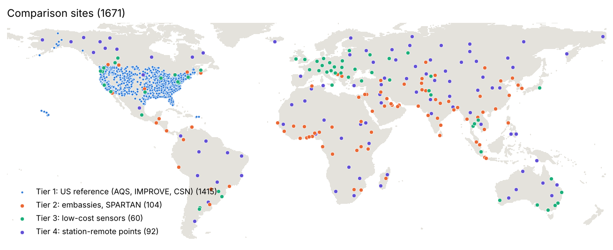

# air-quality-data-comparison

**Question.** How well do gridded near-surface air-quality products reproduce what monitors
measure? The variables are PM2.5, PM10, the main PM2.5 components, O3 and NO2, at hourly,
daily and monthly scales. Does it matter whether a product uses the monitors itself? And how
far do products disagree with each other away from any monitor?

**What was done.**
- **Products.** Point time series were extracted from 15 product streams at 1,671 sites:
  - Atmospheric models: GEOS-CF v1 and v2, MERRA-2 aerosols, MERRA-2 GMI, GEOS-FP aerosols, NOAA NAQFC/AQM (raw and bias-corrected), HAQES and HRRR-Smoke.
  - Machine-learning or satellite-calibrated products: the bias-corrected MERRA-2 PM2.5 `MERRA2_CNN_HAQAST_PM25`, ACAG V6 and GHAP.
- **Comparison.** Each product was compared with:
  - US reference monitors (EPA AQS/AirNow) and the IMPROVE/CSN filter networks;
  - US embassy monitors and SPARTAN worldwide;
  - Sensor.Community low-cost sensors;
  - 92 station-remote points, where products are scored against each other.
- **Extraction.** Every product is sampled on the 2×2 pixel stencil around each site, giving
  nearest-pixel and bilinear values.
- **Storage.** The series live in per-product Icechunk repositories, quantized and
  pcodec-compressed.
- **Website.** A static site lets you click any site and compare products against the observations.

Site: https://ashiklom.github.io/simon-code-research/air-quality-data-comparison/

## Key results

KEY_RESULTS_PLACEHOLDER

## Data sources

Full rationale is in [PLAN.md](PLAN.md). All values are converted to UTC and stamped at the
**end** of their averaging interval. PM is in µg m⁻³, gases in ppb.

| Product | Access path used | Resolution · period extracted | Variables | Uses surface monitors? |
|---|---|---|---|---|
| GEOS-CF v1 (replay) | NASA SMCE public Zarr `s3://smce-geos-cf-public/geos-cf-rpl.zarr`, anonymous. Only the 50×50-pixel chunks holding sites are read | 0.25°, 1 h, 2018-01 → 2026-01-02 (end of v1) | PM2.5 (35 % RH), O3, NO2, CO | no |
| GEOS-CF v2 (replay) | SMCE Zarr `geos-cf-v2-rpl.zarr` | 0.25°, 1 h, 2025-08-04 → 2026-11-01 | PM2.5, **PM10**, 8 PM2.5 components, O3, NO2, CO | no |
| MERRA-2 aerosols | GES DISC `M2T1NXAER` daily files, HDF5 range reads of whole global fields (Earthdata login) | 0.5°×0.625°, 1 h, 2018-01 → 2026-0x | 7 GOCART species; PM2.5/PM10 computed (below) | no (AOD only) |
| MERRA-2 GMI | NCCS portal `datashare/merra2_gmi` `tavg1_2d_aer_Nx` | 0.5°×0.625°, 1 h, 2018–2023 | PM2.5 incl. nitrate, NO3, NH4 | no |
| MERRA-2 CNN (`MERRA2_CNN_HAQAST_PM25` V1) | GES DISC HAQAST daily files | 0.5°×0.625°, 1 h, 2018-01 → 2026-07 | bias-corrected PM2.5, QA flag | **yes**: trained on OpenAQ reference monitors (incl. AQS/AirNow, embassies) |
| GEOS-FP aerosols | NCCS portal `tavg3_2d_aer_Nx` range reads | 0.3125°×0.25°, 3 h, 2025-08 → now | as MERRA-2, plus nitrate | no (MODIS AOD) |
| NOAA NAQFC/AQM raw | `s3://noaa-nws-naqfc-pds` CONUS 5 km GRIB2, 12 UTC cycle, leads 1–24 h joined | 5 km, 1 h, 2018 → now (gap 2024-04-20..05-13) | PM2.5, O3 | no |
| NOAA NAQFC/AQM bias-corrected | same, `_bc` fields | same | PM2.5, O3 | **yes**: AirNow (analog-ensemble correction) |
| HAQES | GES DISC `HAQES_NA_PM25_{TOT,OC,BC}` | 12 km, 3 h, 2022-01-02 → now | PM2.5, OC, BC | **partly**: members include bias-corrected NAQFC |
| HRRR-Smoke | dynamical.org `noaa-hrrr-analysis-virtual` Icechunk (virtual refs to the NOAA GRIB2) | 3 km, 1 h, 2020-12-02 → now, CONUS | near-surface smoke PM2.5 only | no |
| ACAG V6.GL.03 (+ V6.NA.01 composition) | `s3://satpmdata` monthly NetCDF, windowed reads | 0.01°, monthly, 2018-01 → 2024-12 (NA species → 2023-12) | PM2.5; BC, dust, NH4, NO3, OM, SO4, SS in North America | **yes**: calibrated to ground monitors |
| GHAP (GlobalHighPM2.5 V2) daily and monthly | Zenodo daily 1 km zips, HTTP range requests | 1 km, daily, 2018–2022 (open years) | PM2.5 | **yes**: trained on ~9,500 monitors (OpenAQ, EPA, EEA, CNEMC) |
| CAMS EAC4, CAMS global forecast | ADS API | — | — | not extracted (licence not accepted; see Requirements) |

**PM definitions.**
- GEOS-CF PM2.5 is at 35 % RH, closest to the FRM filter equilibration.
- MERRA-2 and GEOS-FP are GOCART dry mass:
  PM2.5 = DU25 + SS25 + BC + 1.4·OC + SO4·132.14/96.06, with **no nitrate** in MERRA-2. PM10 uses
  the full-size dust and sea salt.
- MERRA-2 GMI adds nitrate and ammonium from full chemistry.
- Component comparisons use the sulfate ion, OM = 1.4·OC for GOCART and OC + SOA for GEOS-CF.
  On the filter side, OM = 1.8·OC, EC ↔ BC, fine soil ↔ dust and sea salt = 1.8·Cl⁻.

## Sites



| Tier | Network | Sites | What |
|---|---|---|---|
| 1 | **EPA AQS** (+ AirNow preliminary data after AQS ends) | 1,309 | Hourly PM2.5 (parameter 88101 FRM/FEM, else 88502 non-regulatory), PM10, O3, NO2; 24-h FRM PM2.5. Monitors with ≥ 4 complete years, thinned to one per 0.25° cell. AirNow fills 2025-07 → now. |
| 1 | **IMPROVE / CSN** (AQS `daily_SPEC` files) | 148 / 86 | 24-h filter PM2.5 components every 3rd (or 6th) day. Of the 234, 128 are AQS sites already listed. |
| 2 | **US embassy and consulate monitors** (AirNow `EmbassyHistorical`) | 85 | Hourly PM2.5 (BAM), 2018 → 2026-11. The files keep going past the reported network stop of 2025-03. |
| 2 | **SPARTAN** (`s3://spartan-cloud`) | 19 | Hourly nephelometer-based PM2.5 and filter components |
| 3 | **Sensor.Community** low-cost (SDS011) | 60 | 2023–2024 hourly PM2.5/PM10 with BME280 RH. 36 sensors are in data-sparse non-European regions, 20 are spread across Europe at least 300 km apart, and 4 sit within 2 km of a reference monitor. |
| 4 | **Station-remote points** | 92 | Stratified by world region × ACAG 2019–2023 PM2.5 class. Each is ≥ 100 km from any AQS, AirNow, embassy, SPARTAN, IMPROVE/CSN or Sensor.Community monitor (median 297 km) and ≥ 300 km from the others. Scored at monthly scale against the median of the other products (leave-one-out). |

Site lists are committed in `results/sites/`.

## Methods in brief

- **Spatial.** Bilinear weights over the 2×2 stencil, renormalized over missing pixels.
  Nearest-pixel is the pixel with the largest weight. Bilinear beats nearest in daily PM2.5
  RMSE at 55–74 % of AQS sites, depending on the product. Both are in the metrics; the
  summaries use bilinear.
- **Time.** UTC, end-of-interval stamps:
  - Hourly means stamped at HH:30 at source (GEOS-CF, MERRA-2, GEOS-FP) are shifted +30 min.
  - The instantaneous products (HRRR-Smoke, HAQES) are flagged and aggregated as instants.
  - Station local times are converted with each site's standard UTC offset. Half-hour
    offsets (India, Myanmar, …) are rounded *up* to the hour.
- **Lag check.** `results/lagcheck.csv` correlates hourly anomalies of each product with AQS at
  lags of −3..+3 h. LAGCHECK_PLACEHOLDER
- **Daily values** are local-standard-time days with ≥ 18 of 24 hours, matching AQS daily
  summaries and the 24-h filters.
  - O3 uses the daily maximum 8-h average (MDA8). The 3-hourly products use the daily
    maximum of 3-h values instead.
  - GHAP daily values use the UTC day, so station days are re-aggregated to UTC for GHAP.
- **Monthly values** need ≥ 75 % of days. ACAG and GHAP-monthly are compared only monthly.
- **Windows.**

  | Window | Dates |
  |---|---|
  | full | each product's span |
  | common | 2018-01..2023-12 |
  | recent | 2025-08..2026-10 |
  | v1v2 | 2025-08-04..2026-01-02, where GEOS-CF v1 and v2 overlap |
  | smoke | days with HRRR-Smoke daily mean ≥ 20 µg m⁻³ at the site, AQS sites only |

  HRRR-Smoke itself, which contains only smoke, is scored only on those smoke days.
- **Metrics** per site × product × variable × scale × window × method:
  - n, bias, normalized mean bias (NMB), normalized mean error (NME), RMSE, unbiased RMSE,
    Pearson r, Spearman ρ, KGE and 95th percentiles;
  - for daily PM2.5: POD, FAR and CSI at 15 µg m⁻³ (WHO) and 35 µg m⁻³ (US 24-h NAAQS), plus
    US AQI category agreement;
  - for O3 MDA8: the same at 70 ppb.

  Minimum samples: 60 days, 12 months, 60 days of hours, 30 filter days or 5 smoke days.
- **Low-cost sensors.**
  - The primary value is the raw SDS011 PM2.5 with hours above 75 % RH dropped.
  - A κ-Köhler hygroscopic correction (κ = 0.4) is also kept, as `pm25_kappa`. It was not
    chosen because these sensors already read ~40 % low against co-located monitors, and
    the correction pushes them lower (`results/sensor_vs_monitor.csv`).

## Dependence

Scores against monitors are optimistic for products that ingest or were trained on those monitors:

| Product | Dependence |
|---|---|
| GHAP | trained on ~9,500 monitors (OpenAQ, EPA, EEA, CNEMC), including the AQS sites used here |
| ACAG V6 | calibrated to global ground monitors; the North American composition uses IMPROVE/CSN |
| MERRA-2 CNN | trained on OpenAQ reference monitors, which include AQS/AirNow and the embassies |
| NAQFC bias-corrected | analog-ensemble correction against AirNow |
| HAQES | ensemble including AirNow-corrected NAQFC |
| GEOS-CF, MERRA-2, MERRA-2 GMI, GEOS-FP, NAQFC raw, HRRR-Smoke | no surface PM/O3/NO2 observations (satellite AOD, fire radiative power, satellite O3 only) |

The most independent references are IMPROVE, SPARTAN, the low-cost sensors and, for GHAP
and MERRA-2 CNN, the embassies in countries without other OpenAQ data. Tier 4 needs no
observations at all.

## Deviations from the plan

- **Not extracted (needs your action):**
  - **CAMS EAC4 and CAMS forecast.** The ADS API returns 403 until the account accepts the
    ADS terms of use and data-protection statement. The readers (`products/cams.py`) are
    written and tested on synthetic files.
  - **OpenAQ reference monitors, AirGradient and AirQo.** There is no `OPENAQ_API_KEY` or
    AirQo token. The OpenAQ S3 archive has no location index, so monitors cannot be
    selected without the API. Tier 2 is therefore embassies + SPARTAN (104 sites, not
    ~400), and Tier 3 is Sensor.Community only.
- **GEOS-CF:**
  - The public SMCE Zarr stores replace OPeNDAP and portal files for both versions.
  - v1 has no PM components in the Zarr, so v1 species (planned via OPeNDAP) were not
    extracted; v2 species are.
  - The v2 hindcast (2023–2025) was not extracted.
- **MERRA-2 GMI:**
  - Aerosols only, 2018–2023. Its gases were dropped: only daily-mean lowest-level O3/NO2
    are served, at ~40 h per pass.
  - GMI_SKIPPED_PLACEHOLDER days whose files hold corrupt compressed chunks were skipped.
- **Other source changes:**
  - **IMPROVE/CSN** come from the AQS `daily_SPEC` files rather than FED (same data, no form
    interface).
  - **GHAP** covers 2018–2022, the years open on Zenodo.
  - **PM formula.** Only the OC→OM factor 1.4 is reported for MERRA-2/GEOS-FP, not also 1.0.
- **Site selection:**
  - **Remote points** are stratified by region × PM class only, not also dust fraction and
    fire frequency. 92 strata could be filled.
  - **Low-cost sensors.** 60 Sensor.Community sensors over 2023–2024, fewer than the planned
    100–150.
- **Process:**
  - **Pilot.** The pilot (18 sites, 2023) was run to choose access strategies. Following your
    follow-up, the full extraction went ahead without a separate pilot report or checkpoint.
  - **Not computed:** O3 diurnal amplitude and phase, and seasonal stratification. Medians by
    AQS location setting are in `results/summary_by_setting.csv`.

## How to reproduce

```bash
cd air-quality-data-comparison
mise install            # Python 3.13, uv, Node 22
uv sync
mise run sites          # site tables (committed in results/sites/)
mise run all            # obs ingest, extraction/update of every product, metrics, lag check, figures, site data, site
```

Individual steps:
- `uv run aqc extract <product...> --sites pilot|tier1|tier2|tier3|tier4|<network>|all [--start/--end]`
  extracts products at a set of sites.
- `uv run aqc status` shows each product's sites and extracted end.
- `uv run aqc update` fetches only the missing tail of every product.
- `uv run aqc metrics --sites all --workers 2` writes `data/results/metrics_all.parquet`
  (~230,000 rows).
- `scripts/summarize.py` and `scripts/key_tables.py` produce the committed tables in `results/`.

**Requirements (credentials, set as environment variables):**

| Variable | Needed for |
|---|---|
| `EARTHDATA_LOGIN_USER` / `EARTHDATA_LOGIN_PASSWORD` (or `EARTHDATA_TOKEN`) | MERRA-2, MERRA-2 CNN, HAQES (GES DISC) |
| `CDSAPI_KEY` (or `ADSAPI_KEY`) for the ADS endpoint, with the ADS licences accepted | CAMS EAC4 and forecast |
| `OPENAQ_API_KEY` | OpenAQ monitors and AirGradient (not yet wired into the run) |

Sources whose credentials are missing or refused are skipped. The rest of the run continues.

**Store location.** The default is local and not persisted: `data/store/<kind>-<name>.icechunk`.
Point everything at another backend with `--store` or `AQC_STORE`, for example
`s3://bucket/prefix?region=us-west-2`.

## Storage

STORAGE_PLACEHOLDER

## Publishing the site data

PUBLISH_PLACEHOLDER

## Limitations

- **Monitor representativeness.** A 0.25°–0.5° grid cell is compared with a point. The
  urban/rural split (`results/summary_by_setting.csv`) shows how much that matters for
  each product.
- **Hourly PM2.5 at AQS is mostly FEM continuous monitors.** These differ from the 24-h FRM
  filters, which is why both `pm25` and `pm25_frm` are scored.
- **Embassy monitors are single urban BAMs**, compared with ≥ 25 km grid cells in
  megacities.
- **Low-cost sensors** are a small, uncalibrated sample. Their skill mixes product error
  with sensor error.
- **Tier 4 compares products with each other.** A product close to the median is not
  necessarily right, and the median is dominated by whichever products cover the point.
- **HRRR-Smoke** contains only smoke. It is compared with total PM2.5 on smoke days, where
  smoke dominates. Its own values define those days, so its POD there is not meaningful.
