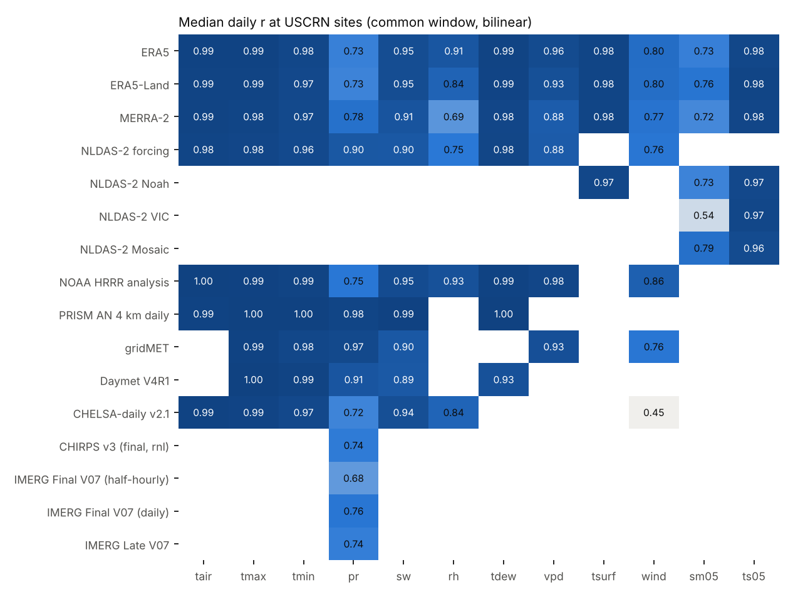
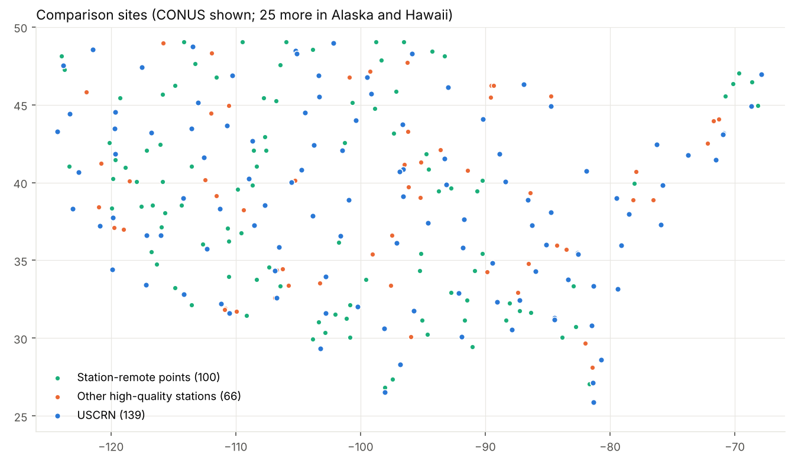

# climate-product-compare

**Question.** How well do widely used gridded weather/climate products reproduce what a
good weather station measures (air temperature, precipitation, humidity, solar radiation,
surface/skin temperature, soil moisture and temperature, wind, snow), and how much does it
matter whether you take the nearest pixel or interpolate?

**What was done.** Point time series were extracted from 17 product streams at ~300 sites
and compared with station observations at hourly, daily and monthly scales:

- **Products.** ERA5, ERA5-Land, MERRA-2, NLDAS-2 (forcing and the Noah/VIC/Mosaic land
  models), GEOS-FP (last 12 months), NOAA HRRR, PRISM, gridMET, Daymet, CHELSA-daily,
  CHIRPS v3, IMERG Final (daily, and half-hourly for summer 2025) and IMERG Late.
- **Sites.**
  - Tier 1: all 139 operational USCRN stations, including Alaska and Hawaii.
  - Tier 2: 66 "good" non-USCRN stations chosen to be as independent of the products as possible.
  - Tier 3: 100 station-remote points stratified by climate and land cover.
- **Extraction.** Every product is sampled on the 2×2 pixel stencil around each site, so
  both nearest-pixel and bilinear values are available.
- **Storage.** The extracted series live in per-product Icechunk repositories, quantized
  and pcodec-compressed, in a public S3 bucket (see "Stores on S3"). A static website lets
  you click any site and compare its series.

Site: https://ashiklom.github.io/simon-code-research/climate-product-compare/

## Key results

Numbers are medians across USCRN stations: daily values, common window (2018-09..2025-08),
bilinear interpolation. All metrics are in the published site data (`summary.json`, per-site
`metrics.json`; see "Publishing the site data") and can be regenerated with `mise run metrics`.



| Product | Tmax RMSE (°C) | Tmin bias (°C) | Precip r | Precip CSI ≥1 mm | Hourly T r |
|---|---|---|---|---|---|
| PRISM 4 km | **0.47** | +0.3 | **0.98** | **0.86** | – |
| Daymet V4R1 | 0.97 | +0.3 | 0.91 | 0.73 | – |
| gridMET | 1.30 | +0.2 | 0.97 | 0.84 | – |
| HRRR analysis | 1.16 | +1.0 | 0.75 | 0.68 | **0.99** |
| ERA5 | 1.65 | +1.6 | 0.73 | 0.59 | 0.98 |
| ERA5-Land | 1.79 | +1.8 | 0.73 | 0.59 | 0.98 |
| MERRA-2 | 2.12 | +1.1 | 0.78 | 0.57 | 0.97 |
| NLDAS-2 forcing | 2.35 | +2.0 | 0.90 | 0.72 | 0.97 |
| CHELSA-daily | 1.94 | +2.0 | 0.71 | 0.57 | – |
| IMERG Final (daily) | – | – | 0.76 | 0.53 | – |
| IMERG Late | – | – | 0.74 | 0.53 | – |
| CHIRPS v3 | – | – | 0.74 | 0.51 | – |

- **Station-interpolated products (PRISM, gridMET, Daymet) look best at USCRN, but USCRN is
  one of their inputs.**
  - At SCAN and Iowa ISUSM stations, which they do not ingest, PRISM's daily precipitation r
    drops from 0.98 to 0.77–0.86. gridMET drops from 0.97 to 0.74–0.85.
  - Every product scores lower at those gauges (ERA5: 0.73 → 0.58), so part of the gap is
    gauge quality, not only dependence.
  - Station-based products still rank first for daily precipitation everywhere, by a
    smaller margin.
- **At the 41 NEON and AmeriFlux towers, the most independent stations, the same ranking holds
  with a smaller lead.** Neither network feeds GHCN-D, MADIS or PRISM. Medians over towers,
  daily values, common window:
  - Daily precipitation r: PRISM 0.92, gridMET 0.90, NLDAS-2 0.85, Daymet 0.84, IMERG Final
    and MERRA-2 0.73, HRRR and CHIRPS 0.70, ERA5 0.63. That is 0.03–0.10 below each product's
    USCRN score, for station-based products and reanalyses alike. Tower gauges are less
    carefully sited than USCRN's, so the drop is not all dependence. (39 of the 41 towers
    report precipitation.)
  - Daily mean temperature RMSE: HRRR 0.96 °C, PRISM 1.32, ERA5 1.36, CHELSA 1.47, ERA5-Land
    1.55, MERRA-2 1.72, NLDAS-2 2.03. PRISM's lead over ERA5 disappears at towers it does not
    ingest (at USCRN: 1.10 vs 1.57). These networks report hourly air temperature, so daily
    Tmax/Tmin are not scored there.
  - Shortwave is +4 to +9 W m⁻² for the models (HRRR +3.8, ERA5 +4.7, MERRA-2 +9.4), as at
    SURFRAD, which supports the reading that USCRN's pyranometers are low (below).
- **Every reanalysis has warm nights.**
  - Daily-minimum temperature bias is +1.0 to +2.0 °C for HRRR, ERA5, ERA5-Land, MERRA-2,
    NLDAS-2 and CHELSA. Daily maxima are slightly cool (−0.3 to −0.8 °C).
  - Station-interpolated products have Tmin bias ≤ 0.3 °C.
  - See `results/figures/bias_USCRN_common.png`.
- **HRRR is the best model-based product** for temperature, dewpoint and RH: hourly
  temperature r 0.99, daily Tmax RMSE 1.2 °C. Its precipitation (0–1 h forecast) is 20 % low
  overall: total ratio 0.80.
- **Precipitation from satellites and reanalyses is weak day to day but fine in aggregate.**
  - Daily r is 0.71–0.78 for ERA5, ERA5-Land, MERRA-2, CHELSA, IMERG and CHIRPS, against
    0.90–0.98 for gauge-based products.
  - At monthly scale ERA5 reaches 0.84, IMERG Final 0.87, CHIRPS 0.91, NLDAS-2 0.93 and
    PRISM 0.99.
  - Totals are within −5 %/+7 % for all but HRRR (and the short half-hourly IMERG Final sample, +10 %).
  - NLDAS-2 forcing has the best hourly precipitation timing (r 0.76 vs 0.36–0.52 for
    ERA5/HRRR/IMERG), thanks to its radar-based disaggregation.
- **Solar radiation: USCRN reads low.**
  - Products look about +20 W m⁻² too high against USCRN, but only about +8 W m⁻² against
    SURFRAD's research-grade radiometers (ERA5 +7.4, HRRR +7.3) and +4 to +9 W m⁻² at the
    NEON and AmeriFlux towers.
  - At the four SURFRAD sites that host a USCRN station, USCRN reads 5–11 W m⁻² (3–5 %)
    below SURFRAD on average.
  - The gap grows over time, to −10 to −20 W m⁻² in the latest year
    (`results/uscrn_vs_surfrad_sw.csv`), which looks like sensor drift.
- **GEOS-FP (12-month recent window, 2025-11..2026-10)** behaves like the other global
  reanalyses: daily Tmax RMSE 1.96 °C, Tmin bias +1.5 °C, precipitation r 0.71, shortwave
  +25 W m⁻² vs USCRN.
  - Over the same window ERA5 is very similar (Tmax RMSE 1.67 °C, Tmin +1.4 °C, precipitation
    r 0.72, shortwave +24 W m⁻²). ERA5 now covers the whole window: its free copy ends
    2026-06-30 and the rest comes from ERA5T (see Data sources).
  - HRRR (Tmax RMSE 1.15 °C) and PRISM (0.46 °C) remain best.
- **CHELSA-daily** reproduces temperature well (Tmax RMSE 1.9 °C) but carries the reanalysis
  warm-night bias (Tmin +2.0 °C). It is +45 W m⁻² high in shortwave and 10 % dry in RH
  against USCRN, and has the weakest wind (r 0.45).
- **At the 100 station-remote points**, there are no observations, so each product is
  compared with the median of the other products' monthly values (common window). The
  station-side patterns persist away from stations:
  - **Night-time temperature.** PRISM, gridMET and Daymet are 1.5–1.8 °C cooler in Tmin than
    the median of the others. NLDAS-2 and ERA5-Land are 1.0–1.4 °C warmer. That is the same
    ~2–3 °C split seen against USCRN, where the station-based products are right.
  - **Precipitation.** Monthly totals agree within ±10 % (r 0.89–0.96 with the others),
    except HRRR (−25 %) and IMERG Late (r 0.83).
  - **Shortwave.** It is the most product-dependent variable: CHELSA +29, MERRA-2 +7,
    PRISM −14 and Daymet −23 W m⁻² relative to the others.
  - Daily comparisons at these points mix day definitions (UTC vs 12 UTC vs local), so use
    the monthly scale. Day-by-day medians of intermittent precipitation are also biased low.
- **Day definitions matter, and two products don't match their documentation.**
  - Daymet and gridMET daily precipitation line up best with station days ending 12 UTC of
    the *next* day. r is 0.90 for both, against 0.87 (Daymet) and 0.83 (gridMET) on their
    documented days. That is the morning-observation convention of the COOP gauges behind them.
  - PRISM's documented 12–12 UTC day, and the UTC day for CHIRPS and IMERG, are confirmed.
  - All hourly products line up at lag 0 once their stamps are converted to end-of-interval.
- **Nearest-pixel vs bilinear barely matters.** Bilinear interpolation of the 4 surrounding
  pixels beats the nearest pixel at 51–53 % of sites for temperature and 68 % for
  precipitation, by a few hundredths in RMSE.
- **Soil moisture.**
  - Daily anomaly correlations are ≈ 0.6–0.7 near the surface (NLDAS-2 Mosaic 0.70,
    ERA5-Land 0.68, ERA5 0.66, NLDAS-2 Noah 0.60; VIC 0.47) and ≈ 0.5 at 50–100 cm.
  - Absolute values are not comparable across models.
  - Soil temperature is well reproduced (r ≈ 0.96–0.98), but NLDAS-2 Noah/Mosaic are
    about 2.4–2.5 °C cold at 5 cm.
- **Snow (6 SNOTEL sites).**
  - SWE r: ERA5 0.80, Daymet 0.73, NLDAS-2 Noah 0.64, HRRR 0.45 (full record).
  - Snow depth r: ERA5-Land 0.71, MERRA-2 0.57, HRRR 0.52.
- **Wind** is the weakest variable everywhere: daily r 0.76–0.86, CHELSA 0.45. Raw 10 m
  products are 1–2 m s⁻¹ faster than the 1.5 m USCRN anemometers. A log-law height
  adjustment is in the metrics (`wind_adj`).
- **Storage.** Quantizing to fixed absolute steps before pcodec shrinks the store 2.5× vs
  lossless pcodec and 3.6× vs zstd (ERA5 0.81 vs 2.08 vs 2.89 bytes/value). Metrics move by at
  most 0.0004 in r (`results/pilot/compression_*.csv`). All site extracts take 12.9 GB (40 GB
  if every product's complete record were extracted). Complete optimized copies of the used
  variables would take ~70–115 TB; the original products with all variables take 1.8–5.9 PB
  (see [Storage volume per complete product](#storage-volume-per-complete-product)). One
  such copy was built: gridMET's 9 variables for CONUS, 1979 → 2026-11, take 48.9 GB.


## Data sources (what was read, and why)

Full rationale, chunking and conventions are in [PLAN.md](PLAN.md). In short:

| Product | Access path used | Resolution · period |
|---|---|---|
| ERA5 | Earthmover free Icechunk copy (`s3://earthmover-icechunk-era5/icechunkV2`, `single/temporal`), anonymous; the months after it ends are filled with preliminary ERA5T from the CDS point time-series dataset `reanalysis-era5-single-levels-timeseries` (one request per stencil pixel), CDS key | 0.25° hourly, 1940 → 2026-06 (final) + ERA5T to ~10 days ago |
| ERA5-Land | ECMWF CDS ARCO **geoChunked** Zarr (`arco.datastores.ecmwf.int/cadl-arco-geo-*`), CDS key | 0.1° hourly, 1950 → ~5 days ago |
| MERRA-2 | NASA POWER MERRA-2 hourly Zarr (native grid) + Giovanni time-series API for SWGDN | 0.5°×0.625° hourly |
| NLDAS-2 forcing, Noah, VIC, Mosaic | NASA Giovanni time-series API (Hydrology Data Rods is retired) | 0.125° hourly |
| NLDAS-3 | not released (only 2001–2023 *beta forcing* exists); not extracted | — |
| GEOS-FP | NCCS HTTPS portal `tavg1_2d_{slv,flx,rad,lnd}_Nx`, HDF5 range reads | 0.3125°×0.25° hourly, 2025-11 → now |
| HRRR | dynamical.org `noaa-hrrr-analysis` Icechunk | 3 km hourly, 2014-10 → now |
| PRISM | PRISM daily AN 4 km zipped COGs (data.prism.oregonstate.edu) | 4 km daily, day ends 12 UTC |
| gridMET | Northwest Knowledge THREDDS OPeNDAP aggregations | 1/24° daily |
| Daymet V4R1 | ORNL DAAC via Earthdata **Cloud OPeNDAP** (server-side subsetting) | 1 km daily, 1980–2025 |
| CHELSA-daily v2.1 | EnviCloud COGs, windowed reads | 30″ daily, to 2025-09 |
| CHIRPS v3 (final, rnl) | dynamical.org `ucsb-chc-chirps-analysis-final` Icechunk | 0.05° daily |
| IMERG Final V07 | GES DISC HDF5 range reads (no time-series-chunked copy exists) | 0.1° daily 1998–2025-09; half-hourly JJA 2025 only |
| IMERG Late V07 | dynamical.org `nasa-imerg-analysis-late` Icechunk | 0.1° half-hourly |

## Sites



- **Tier 1, USCRN** (139 stations: 114 CONUS, 23 Alaska, 2 Hawaii; `results/sites/uscrn.csv`).
  - Variables from `hourly02`: air temperature (hourly mean, max, min), precipitation,
    solar radiation, infrared surface temperature, RH (plus dewpoint and VPD derived from
    it), and soil moisture and temperature at 5/10/20/50/100 cm.
  - Wind at 1.5 m comes from the 5-minute `subhourly01` files.
  - USCRN is the best reference available, but it is *not* independent of PRISM, Daymet
    (via GHCN-D) or HRRR (via MADIS).
- **Tier 2** (`results/sites/tier2.csv`, with a per-site independence note and the
  distance to the nearest GHCN-D and USCRN station):
  - 28 NEON towers and 13 long-record AmeriFlux BASE sites. Neither network feeds GHCN-D,
    MADIS or PRISM. These need credentials (see below). NEON gives air temperature (lowest
    single-aspirated level), RH, precipitation, pressure, wind and shortwave; AmeriFlux BASE
    gives the same set at 30- or 60-minute steps. Neither is used for
    soil variables.
  - 7 SURFRAD sites: research-grade radiation, temperature, RH and wind.
  - 8 SCAN and 4 Iowa ISUSM stations: not in GHCN-D, but in MADIS. Chosen to be more than
    1 km from any GHCN-D or USCRN station.
  - 6 SNOTEL sites as the snow (SWE and depth) reference. These are in GHCN-D, which is
    flagged.
- **Tier 3** (`results/sites/remote.csv`): 100 CONUS points.
  - Stratified by Köppen-Geiger 1991–2020 (Beck et al. 2023) × MODIS MCD12C1 IGBP group.
  - Within each stratum, the point farthest from any GHCN-D, USCRN, SCAN, SNOTEL, ISUSM,
    NEON or AmeriFlux station is picked, with points at least 75 km apart.
  - Median distance to a station is 32 km (18–69 km).

## Methods in brief

- **Spatial.** Each product is sampled on the 2×2 stencil of pixels enclosing the site.
  Nearest-neighbour is the pixel with the largest bilinear weight. Bilinear weights are
  renormalized when a pixel is masked (ocean or outside the domain).
- **Time conventions.**
  - Everything is converted to UTC, stamped at the end of its averaging or accumulation interval.
  - Shifts applied: MERRA-2 and GEOS-FP hourly means are stamped at HH:30 at source, so
    +30 min; IMERG files carry their start time, so +30 min; HRRR precipitation is the
    previous run's 0–1 h forecast.
  - All conventions were verified by lag correlation against USCRN
    (`results/pilot/lagcheck_*.csv`): hourly air temperature and precipitation peak at lag 0
    for every hourly product.
- **Daily values** use each product's own day:

  | Product | Day definition |
  |---|---|
  | PRISM | ends 12 UTC |
  | gridMET | ends 07 UTC next day |
  | Daymet | local day |
  | CHIRPS, IMERG | UTC day |
  | CHELSA | tasmax/tasmin over 06–06 UTC |

  Station data are aggregated to the same window.
- **Empirical day-window overrides.** The lag check shows that **Daymet and gridMET
  precipitation line up best with station days ending 12 UTC of the *next* day**,
  i.e. the morning-observation convention of the gauges behind them, not their documented
  windows. These two are scored on the empirically aligned day
  (`results/day_window_overrides_*.csv`).
- **Metrics** per site × product × variable × scale (hourly/daily/monthly) × window
  (full overlap, common 2018-09..2025-08, recent 2025-11..2026-10) × nearest/bilinear:
  - Continuous variables: bias, MAE, RMSE, unbiased RMSE, r, KGE.
  - Precipitation: totals ratio, POD/FAR/CSI at 0.25/1/10 mm d⁻¹, and 95th/99th-percentile ratios.
  - Soil moisture: anomaly correlation, because absolute values aren't comparable across
    depths and models. Layers are matched by depth.
  - Wind: compared raw (10 m vs 1.5 m) and log-law adjusted to 1.5 m.

## Deviations from the plan

The plan (PLAN.md) was followed except for these points, all forced by access or throughput:

- **Store layout.** There is one Icechunk repo per product and per station network
  (`<root>/products-<name>.icechunk`), not a single repo. This allows concurrent writers.
  Repos are compacted (old snapshots expired, then garbage-collected) during and after
  extraction, because block-wise appends otherwise keep every rewritten chunk.
- **CHELSA** covers the common window only (2018-09 → 2025-09). It has one COG per
  variable-day, and the reads cost about 17 s per file for 305 sites.
- **IMERG Final half-hourly** covers June–August 2025 only (see Limitations).
- **NLDAS-2 land models** include only the variables Giovanni serves. **NLDAS-3** was not
  extracted.
- **Tier 2.**
  - DEOS, FAWN, Michigan Enviroweather and the Walnut Gulch gauges were dropped. SCAN was
    expanded from 2 to 8 sites instead: open API, soil moisture, and not in GHCN-D.
  - NEON and AmeriFlux were added once credentials were available (2026-11).
- **Daily day windows.** For Daymet and gridMET precipitation, metrics use the empirically
  aligned window instead of the documented one (see Key results).
- **Soil-moisture quantum** is 1e-5 m³ m⁻³, not 1e-3. The pilot showed that 1e-4 moved
  deep-layer correlations at a dry site by 0.02.

## Storage and compression

Measured on S3 after extracting every site and compacting history (2026-11-19). Each value
is stored as float32, rounded to a fixed absolute step (0.01 °C, 0.01 mm, 0.1 W m⁻², 1e-5
m³ m⁻³, ...) and pcodec-encoded in Icechunk. Full table: `results/store_sizes.csv`.

| Product | Sites | Size | MB per site | Bytes per value | Plan estimate (sites only) |
|---|---|---|---|---|---|
| ERA5 (16 vars, hourly) | 305 | 2.75 GB | 9.0 | 0.85 | 1.5–4 GB |
| ERA5-Land (18 vars, hourly) | 305 | 2.69 GB | 8.8 | 0.74 | 1.5–4 GB |
| MERRA-2 (19 vars, hourly) | 305 | 2.63 GB | 8.6 | 0.69 | 1.5–4.5 GB |
| NLDAS-2 forcing (9 vars) | 280 | 1.24 GB | 4.4 | 0.74 | 0.5–1.5 GB |
| NLDAS-2 Noah + VIC + Mosaic | 280 | 1.91 GB | 6.8 | 0.52–0.62 | 2–6 GB |
| HRRR (10 vars) | 280 | 0.85 GB | 3.0 | 0.72 | 0.5–1.5 GB |
| GEOS-FP (19 vars, 12.7 months) | 305 | 0.18 GB | 0.60 | 0.86 | 0.1–0.25 GB |
| IMERG Late (half-hourly) | 305 | 57 MB | 0.19 | 0.14 | 0.1–0.2 GB |
| PRISM 4 km (8 vars, daily) | 280 | 85 MB | 0.30 | 1.37 | 30–70 MB |
| gridMET (9 vars, daily) | 280 | 76 MB | 0.27 | 1.10 | 40–90 MB |
| Daymet (7 vars, daily) | 305 | 66 MB | 0.22 | 1.18 | 30–70 MB |
| CHELSA (9 vars, daily, common window only) | 305 | 30 MB | 0.10 | 1.08 | 40–100 MB (full period) |
| IMERG Final daily / half-hourly (JJA 2025) | 305 | 6.4 / 0.8 MB | 0.02 / 0.003 | 0.81 / 0.15 | 0.1–0.2 GB |
| CHIRPS v3 (daily) | 290 | 7 MB | 0.02 | 0.89 | ~3 MB |
| Station observations (7 networks) | 205 | 301 MB | 0.45–1.7 | 0.31–1.17 | <2 GB |
| **Total** | | **12.9 GB** | | | **8–25 GB** |

- **Hourly products** land at 0.5–0.9 bytes per value, as the plan assumed, which puts them
  inside the estimated range.
- **Daily products** need 0.8–1.4 bytes per value, above the assumed 0.7–0.8. Day-to-day
  series are less smooth than hour-to-hour ones. A full-grid store does better, because
  pcodec can also use spatial smoothness (see below).
- **Layout on S3.** Every array is sharded as 64 sites × one time block (92 days half-hourly,
  1 year hourly, 4 years daily) per object, with one inner chunk per site, so a one-site read
  is a byte-range read of 10–40 KB. The 24 site repos hold 11,312 objects, including
  Icechunk manifests and snapshots. The daily stores came out 15–30 % smaller than the
  earlier local, unsharded ones (e.g. PRISM 106 → 85 MB); the hourly ones are unchanged.
- **Compression study** on 3 pilot sites (`results/pilot/compression_*.csv`):
  - Quantized pcodec stores 0.40–0.78× the bytes of lossless pcodec. ERA5: 0.81 vs 2.08
    bytes/value; zstd needs 2.89.
  - gridMET gains nothing, since its source is already packed at 0.1-unit resolution.
  - Metric changes from quantization (common window): r ≤ 0.0004, anomaly r ≤ 0.0001, daily
    bias ≤ 0.006 in the variable's units.
  - The first pass used a 1e-4 m³ m⁻³ soil-moisture step, which moved deep-layer r at a dry
    site by 0.02. That is why the step is 1e-5.

### Storage volume per complete product

Four sizes per product, as requested: (1) the complete product in its original format with
all variables; (2) only the variables used here, still in the original format; (3) those
variables quantized + pcodec in Icechunk, chunked as 16×16 pixels × the full record; and
(4) as 3, but only at the extracted sites, over the complete record. "Complete" runs from the
product's first time step to the date extracted here; GEOS-FP is per 12 months. The last
column is the measured site store from the table above (2008 onward). The same table, with
the basis for each number, is the **Storage** tab of the
[site](https://ashiklom.github.io/simon-code-research/climate-product-compare/). Data:
`results/storage_estimates.csv`; code: `src/cpc/storage_estimates.py` (`mise run storage`).

| Product | Record | 1. Complete, all vars (original) | 2. Complete, used vars (original) | 3. Complete, used vars, optimized Icechunk | 4. As 3, sites only (complete record) | Measured: our site store |
|---|---|---|---|---|---|---|
| ERA5 | 1940-01-01 – 2026-11-08 | 1.3–5 PB | 24–31 TB | 5.5–7.4 TB | 13 GB | 2.8 GB |
| ERA5-Land | 1950-01-01 – 2026-11-08 | 118–187 TB | 40–64 TB | 11–17 TB | 11 GB | 2.7 GB |
| MERRA-2 | 1980-01-01 – 2026-10-02 | 200–450 TB | 1.8–2.8 TB | 837 GB–1.1 TB | 6.6 GB | 2.6 GB |
| NLDAS-2 forcing | 1979-01-01 – 2026-11-13 | 1.3–1.4 TB | 427–507 GB | 116–199 GB | 3.1 GB | 1.2 GB |
| NLDAS-2 Noah | 1979-01-01 – 2026-11-12 | 2.9–3.1 TB | 483–821 GB | 98–168 GB | 2.7 GB | 1 GB |
| NLDAS-2 VIC | 1979-01-01 – 2026-11-12 | 2.4 TB | 181–283 GB | 43–74 GB | 1.2 GB | 459 MB |
| NLDAS-2 Mosaic | 1979-01-01 – 2026-11-12 | 2.4 TB | 205–320 GB | 37–64 GB | 1 GB | 398 MB |
| GEOS-FP (per 12 months) | 12 months | 20–30 TB | 200–400 GB | 67–106 GB | 174 MB | 182 MB |
| HRRR (analysis) | 2014-10-01 – 2026-11-18 | 85–123 TB | 1.1–1.4 TB | 744 GB–1 TB | 852 MB | 852 MB |
| PRISM 4 km | 1981-01-01 – 2026-11-17 | 268–349 GB | 268–349 GB | 57–87 GB | 206 MB | 85 MB |
| gridMET | 1979-01-01 – 2026-11-15 | 46–115 GB | 26–65 GB | 42–62 GB | 194 MB | 76 MB |
| Daymet V4R1 | 1980-01-01 – 2025-12-31 | 2.9–4.5 TB | 2.9–4.5 TB | 2.2–4.3 TB | 169 MB | 66 MB |
| CHELSA-daily | 1941-01-01 – 2025-09-09 | 50–67 TB | 48–65 TB | 47–83 TB | 366 MB | 30 MB |
| CHIRPS v3 | 1981-01-01 – 2026-10-31 | 390–532 GB | 168–186 GB | 42–67 GB | 17 MB | 7.1 MB |
| IMERG Final V07 (HH + daily) | 1998-06-01 – 2025-09-30 | 3.8–4.7 TB | 424 GB–1.1 TB | 375–514 GB | 99 MB | 7.2 MB |
| IMERG Late V07 | 1998-06-01 – 2026-11-17 | 3.9–4.5 TB | 374 GB–1 TB | 356–482 GB | 86 MB | 57 MB |
| **Total** (excl. GEOS-FP) | | **1.8–5.9 PB** | **120–172 TB** | **68–116 TB** | **40 GB** | **13 GB** (incl. GEOS-FP) |

How the numbers were made:

- **Original format (1, 2).** Real file sizes × the number of files in the record. Sizes come
  from HTTP HEAD requests, bucket listings and GRIB `.idx` byte offsets, sampled 2026-11-13.
  "Used" keeps only the source variables read here, prorated by their share of the bytes when
  a file holds many variables.
  - Three numbers are order-of-magnitude estimates, not measurements: MERRA-2's 3-D
    collections, GEOS-FP's other collections, and ERA5 beyond its single and pressure levels.
  - HRRR "all" counts the analysis (f00) files only. The whole AWS archive, with every
    forecast hour, is several PB.
- **Optimized (3).** Bytes/value were measured by re-encoding random full-grid blocks (16×16
  pixels × 1 year, land and ocean) from the ERA5, ERA5-Land, MERRA-2, HRRR, CHIRPS and IMERG
  Late ARCO copies, plus one full year of gridMET tmmx and pr
  (`results/storage_fullgrid_bpv.csv`). Each variable uses the better of two in-chunk layouts.
  - Full-grid blocks need 0.57–0.98× the bytes/value of our site store. Storing a chunk in
    (time, y, x) order lets pcodec use spatial smoothness (gridMET tmmx: 0.66 vs 1.13 B/value).
    The site store has no spatial neighbours to exploit.
  - Products without an ARCO copy use their site-store bytes/value × the ratio range measured
    for products with the same time step.
- **Sites only (4).** The measured site store, scaled from the extracted period to the
  complete record.

What it shows:

- **Share of used variables.** About 1 % of ERA5, MERRA-2 and the HRRR analysis archive, a
  third of ERA5-Land and NLDAS-2 forcing, and nearly all of PRISM, Daymet and CHELSA.
- **Quantization vs the original files.**
  - 3–5× smaller than the GRIB/NetCDF originals for ERA5, ERA5-Land, NLDAS-2, PRISM and
    CHIRPS.
  - ~1.3× smaller for HRRR (its GRIB2 is already well packed). About the same for gridMET and
    IMERG.
  - The same or larger for the 1 km daily products (Daymet, CHELSA). Their originals are 2-D
    compressed images at 0.1-unit precision. The CHELSA figure is probably high: it borrows
    gridMET's full-grid ratio, and CHELSA is spatially smoother.
  - So for these products a time-series Icechunk copy buys fast point reads, not space.
- **Sites only.** Each product shrinks by 2.5–5 orders of magnitude: 40 GB for all 17
  products over their complete records, against ~70–115 TB for complete optimized copies.
- **Against the plan.** These replace the rough plan-time estimates in
  [PLAN.md](PLAN.md#storage-volume-estimates-per-product). The biggest revisions are
  ERA5-Land (all variables 0.12–0.19 PB, not 0.3–0.6 PB) and CHELSA (50–67 TB, not 90–100 TB).

## How to reproduce

```bash
cd climate-product-compare
mise install            # Python 3.13, uv, Node 22
uv sync
mise run sites          # USCRN table; `uv run cpc sites --tier2 --remote` re-derives the other two lists
                        # (committed in results/sites/; --remote needs the Koppen-Geiger zip and MODIS MCD12C1)
mise run all            # obs ingest, extraction/update of every product, lag check, metrics, figures, site data, site
```

Individual steps:
- `uv run cpc extract <product...> --sites pilot|uscrn|tier2|remote|all` extracts products at a set of sites.
- `uv run cpc status` shows progress.
- `uv run cpc update [--dry-run]` brings every product (and the station networks) up to the
  latest available time. It fetches only the missing span plus each product's
  provisional-revision window, and skips anything already current.

**Requirements (credentials, set as environment variables):**

| Variable | Needed for |
|---|---|
| `CDSAPI_KEY` | ERA5-Land ARCO |
| `EARTHDATA_LOGIN_USER` / `EARTHDATA_LOGIN_PASSWORD` (or `EARTHDATA_TOKEN`) | Giovanni (MERRA-2 SW, NLDAS-2), Daymet, IMERG Final, MODIS land cover |
| `CDSAPI_KEY` | also ERA5T after the Earthmover copy ends |
| `NEON_API_TOKEN` or `NEON_API_KEY` | NEON towers |
| `AMERIFLUX_USER_ID` / `AMERIFLUX_EMAIL` or `AMERIFLUX_USER_EMAIL` | AmeriFlux BASE |
| AWS profile with write access (here `ycgs-all-buckets-writer`) | writing the stores to S3 (reading is anonymous through CloudFront) |

Without the NEON and AmeriFlux variables those networks are skipped and retried on the next
run. PRISM's TLS chain needs the emSign Root CA G1, which is added for PRISM requests only
(`certs/`, SHA-256 `40:F6:AF:…:D0:03:67`, checked against Mozilla's bundle).

**Store location.** The default is local: `data/store/<kind>-<name>.icechunk`. Point
everything at another backend with `--store` or `CPC_STORE`, for example
`s3://bucket/prefix?region=us-east-1&profile=<aws-profile>&storage_class=INTELLIGENT_TIERING`
(read/write) or `https://<cloudfront>/prefix` (read-only), and copy with
`mise run store-copy -- file://$PWD/data/store s3://bucket/prefix`.

## Stores on S3

The stores behind these results are public, in `s3://ycgs-use1-public/simon-code-research/climate-product-compare/stores/`
(Intelligent-Tiering). Read them anonymously through CloudFront, without AWS credentials:

```bash
CPC_STORE=https://d3v5kb9d29awwb.cloudfront.net/simon-code-research/climate-product-compare/stores uv run cpc status
```

Direct S3 access is requester-pays. The results above come from these snapshots (the tip of
`main` on 2026-11-19; `results/store_snapshots.json`). Open one with
`repo.readonly_session(snapshot_id=...)` to reproduce them after later updates.

| Repo | Snapshot |
|---|---|
| `conus-gridmet` | `AW983WK9QE19WS5SK800` |
| `obs-AMERIFLUX` | `WJVA563TS2M74ZCMPZBG` |
| `obs-ISUSM` | `QRQ02341QR6GYM6PKBD0` |
| `obs-NEON` | `0N0NH9R78AZFNYVHAG7G` |
| `obs-SCAN` | `8E5KGPJGBRB7WT644630` |
| `obs-SNOTEL` | `BCDV8FR2J9A2HQKCNZ30` |
| `obs-SURFRAD` | `X8164269PE5Z9PFCHFE0` |
| `obs-USCRN` | `8J2JH92TNRYBXK0FSC50` |
| `products-chelsa` | `29CPY221H6VJ1RTETK90` |
| `products-chirps3` | `REJ9H39KTEAYEZ54Z8M0` |
| `products-daymet` | `M39YX17SFXX5ZPJ7R6KG` |
| `products-era5` | `K5Q5KYAS8SBBZHZ5HP70` |
| `products-era5land` | `F3SMB8ZEPSJ7J3R5R410` |
| `products-geosfp` | `WN6C8T2CZDJ3M1PS9HG0` |
| `products-gridmet` | `JEZ5W1ZM7XNMJK6BX20G` |
| `products-hrrr` | `4D1TCRBQRNRCVSZJRGZ0` |
| `products-imerg_final_daily` | `QW6TJR95J8K2PPHAXCS0` |
| `products-imerg_final_hh` | `X23NGQZRFY82PR5M8W7G` |
| `products-imerg_late` | `X6658S6SJREYGQXT3XQ0` |
| `products-merra2` | `M6676X7J5DATRY2WB0KG` |
| `products-nldas2_forcing` | `6T9BWTSADTJH3BV4W8Y0` |
| `products-nldas2_mosaic` | `AYN5B47EGES5JXG7HB70` |
| `products-nldas2_noah` | `84GJ15PYXVWZGF9KSP00` |
| `products-nldas2_vic` | `J7SCQBXPW7FDF9X7V9VG` |
| `products-prism` | `9M7D16CVWY8C9D7N70FG` |

- **Site stores** (`products-*`, `obs-*`): 12.9 GB, the series described above.
- **`conus-gridmet`**: an analysis-ready copy of gridMET for all of CONUS, 9 variables (tmmx,
  tmmn, pr, rmax, rmin, sph, srad, vs, vpd), 1979-01-01 → 2026-11-17, 48.9 GB in 2,386
  objects. It uses the same quantization and pcodec as the site stores. Each variable is
  sharded as one 366-day × full-grid object (30–80 MB) with (366, 32, 32) inner chunks, so a
  point's complete record is 47 small byte-range reads. Build or extend it with
  `uv run cpc conus-store`. Layout details are in `src/cpc/conus_store.py`. That is
  slightly under the plan's 51–75 GB estimate and inside the updated 42–62 GB in the table
  below.

## Publishing the site data

The site's per-site Parquet and metrics JSON files (`mise run sitedata` → `site/public/data`,
576 MB, 1,224 files) are not committed here. They live in the public S3 bucket `ycgs-use1-public` under
`simon-code-research/climate-product-compare/site-data/<version>/` and are served through CloudFront.

- **How the site reads it.** The browser fetches the files from CloudFront at the version pinned
  in `site/.env.production` (`VITE_DATA_BASE`), currently `v20261118-f09d87a9`. The version is a date plus a
  hash of the file contents, and objects under it are immutable (`Cache-Control: immutable`), so
  the site and its data always match. Each Parquet file is fetched whole (they are all under
  1.1 MB): CloudFront intermittently omits the CORS header on byte-range (206) responses.
  CI only builds the JavaScript bundle.
- **Local builds.** Without that variable (`npm run dev`), the site reads the local `./data`.
- **Updating.** `mise run publish-site-data` runs `_helpers/publish_s3.py site`, which uploads a
  new version (Intelligent-Tiering storage class) and re-pins `.env.production`; commit that file
  here. Once `main` pins the new version, `uv run ../_helpers/publish_s3.py prune climate-product-compare --keep <version>`
  removes the old ones.
- **History.** Until 2026-11 the data lived in
  [ashiklom/simon-code-research-assets](https://github.com/ashiklom/simon-code-research-assets/tree/2a480a7ec34d18b1d8d99c27bb711810ed26b04a/climate-product-compare)
  at commit `2a480a7`; those files are unchanged there.
- **Tarball.** `mise run pack-site` still makes a `site-data.tar`.

## Limitations

- **NEON and AmeriFlux** use the networks' own QC flags only. The NEON reader takes the
  lowest single-aspirated temperature level and skips soil sensors. Tower sensors sit above
  or within canopies, so they are not always comparable with a 2 m screen height.
- **USCRN is not an independent reference** for PRISM, Daymet and HRRR, which ingest it.
  gridMET inherits PRISM's temperature and precipitation. Treat their USCRN skill as an
  upper bound.
- **Instantaneous vs averaged.**
  - ERA5, ERA5-Land and HRRR state variables are instantaneous at the hour; USCRN hourly
    temperature is the hourly mean.
  - HRRR shortwave is the instantaneous analysis-time flux.
  - Daily max/min from hourly products are the max/min of hourly values, while USCRN's
    come from 5-minute data. This biases product Tmax low and Tmin high.
- **IMERG Final half-hourly** is limited to June–August 2025. GES DISC serves it only as
  per-file HDF5, measured at under 0.4 files/s here (48 files per day of data), and V07
  Final ends 2025-09-30. IMERG Final *daily* covers the full period and IMERG Late covers
  sub-daily behaviour throughout.
- **NLDAS-2 land models.** Only the variables Giovanni serves are included: Noah soil
  moisture/temperature, skin temperature, SWE and snow depth; VIC layers 1–2; Mosaic soil
  moisture and soil temperature. VIC/Mosaic skin temperature and SWE are not served.
- **NLDAS-3** is not released. Only a 2001–2023 *beta* forcing exists. Its virtual store is
  chunked 1 day × 500 × 900 pixels, so extracting our sites would take about 1 TB of
  reads; it was not extracted.
- **ERA5 after 2026-06** is preliminary ERA5T at single grid points from the CDS
  time-series dataset, and may change slightly when ECMWF publishes final ERA5 for those
  months. Replacing it is not automated: ERA5 has no revision window in `cpc update`, so that
  span has to be re-extracted by hand.
- **Wind heights differ**: USCRN 1.5 m, SCAN ~3 m, SURFRAD 10 m, products mostly 10 m.
  A log-law adjustment with z0 = 0.03 m is reported alongside the raw comparison.
- **Representativeness.** A 3 km–60 km pixel is not a point; the nearest-vs-bilinear
  difference and the pixel-minus-station elevation (stored per pixel where the product
  provides it) are reported as diagnostics, not corrected for.
