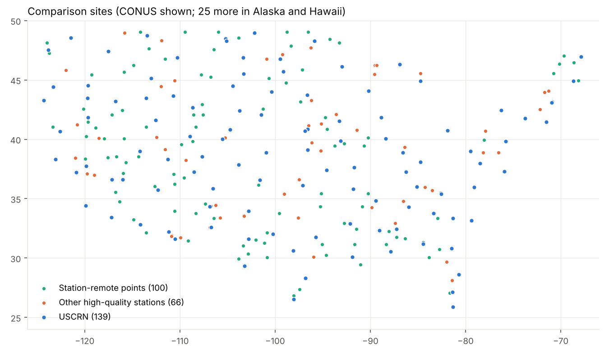

# climate-product-compare

**Question.** How well do widely used gridded weather/climate products reproduce what a
good weather station measures (air temperature, precipitation, humidity, solar radiation,
surface/skin temperature, soil moisture and temperature, wind, snow), and how much does it
matter whether you take the nearest pixel or interpolate?

**What was done.** Point time series were extracted from 17 product streams at ~300 sites
and compared with station observations at hourly, daily and monthly scales:

- **Products.** ERA5, ERA5-Land, MERRA-2, NLDAS-2 (forcing and the Noah/VIC/Mosaic land
  models), GEOS-FP (last 12 months), NOAA HRRR, PRISM, gridMET, Daymet, CHELSA-daily,
  CHIRPS v3, IMERG Final (daily, and half-hourly for 2 years) and IMERG Late.
- **Sites.**
  - Tier 1: all 139 operational USCRN stations, including Alaska and Hawaii.
  - Tier 2: 66 "good" non-USCRN stations chosen to be as independent of the products as possible.
  - Tier 3: 100 station-remote points stratified by climate and land cover.
- **Extraction.** Every product is sampled on the 2×2 pixel stencil around each site, so
  both nearest-pixel and bilinear values are available.
- **Storage.** The extracted series live in per-product Icechunk repositories, quantized
  and pcodec-compressed. A static website lets you click any site and compare its series.

Site: https://ashiklom.github.io/simon-code-research/climate-product-compare/

<!-- RESULTS -->

## Data sources (what was read, and why)

Full rationale, chunking and conventions are in [PLAN.md](PLAN.md). In short:

| Product | Access path used | Resolution · period |
|---|---|---|
| ERA5 | Earthmover free Icechunk copy (`s3://earthmover-icechunk-era5/icechunkV2`, `single/temporal`), anonymous | 0.25° hourly, 1940 → ~3 months ago (quarterly updates) |
| ERA5-Land | ECMWF CDS ARCO **geoChunked** Zarr (`arco.datastores.ecmwf.int/cadl-arco-geo-*`), CDS key | 0.1° hourly, 1950 → ~5 days ago |
| MERRA-2 | NASA POWER MERRA-2 hourly Zarr (native grid) + Giovanni time-series API for SWGDN | 0.5°×0.625° hourly |
| NLDAS-2 forcing, Noah, VIC, Mosaic | NASA Giovanni time-series API (Hydrology Data Rods is retired) | 0.125° hourly |
| NLDAS-3 | not released (only 2001–2023 *beta forcing* exists); not extracted | — |
| GEOS-FP | NCCS HTTPS portal `tavg1_2d_{slv,flx,rad,lnd}_Nx`, HDF5 range reads | 0.3125°×0.25° hourly, 2025-11 → now |
| HRRR | dynamical.org `noaa-hrrr-analysis` Icechunk | 3 km hourly, 2014-10 → now |
| PRISM | PRISM daily AN 4 km zipped COGs (data.prism.oregonstate.edu) | 4 km daily, day ends 12 UTC |
| gridMET | Northwest Knowledge THREDDS OPeNDAP aggregations | 1/24° daily |
| Daymet V4R1 | ORNL DAAC via Earthdata **Cloud OPeNDAP** (server-side subsetting) | 1 km daily, 1980–2025 |
| CHELSA-daily v2.1 | EnviCloud COGs, windowed reads | 30″ daily, to 2025-09 |
| CHIRPS v3 (final, rnl) | dynamical.org `ucsb-chc-chirps-analysis-final` Icechunk | 0.05° daily |
| IMERG Final V07 | GES DISC HDF5 range reads (no time-series-chunked copy exists) | 0.1° daily 1998–2025-09; half-hourly 2023-09..2025-08 |
| IMERG Late V07 | dynamical.org `nasa-imerg-analysis-late` Icechunk | 0.1° half-hourly |

## Sites



- **Tier 1, USCRN** (139 stations: 114 CONUS, 23 Alaska, 2 Hawaii; `results/sites/uscrn.csv`).
  - Variables from `hourly02`: air temperature (hourly mean, max, min), precipitation,
    solar radiation, infrared surface temperature, RH (plus dewpoint and VPD derived from
    it), and soil moisture and temperature at 5/10/20/50/100 cm.
  - Wind at 1.5 m comes from the 5-minute `subhourly01` files.
  - USCRN is the best reference available, but it is *not* independent of PRISM, Daymet
    (via GHCN-D) or HRRR (via MADIS).
- **Tier 2** (`results/sites/tier2.csv`, with a per-site independence note and the
  distance to the nearest GHCN-D and USCRN station):
  - 28 NEON towers and 13 long-record AmeriFlux BASE sites. Neither network feeds GHCN-D,
    MADIS or PRISM. These need credentials (see below) and are wired but not yet ingested.
  - 7 SURFRAD sites: research-grade radiation, temperature, RH and wind.
  - 8 SCAN and 4 Iowa ISUSM stations: not in GHCN-D, but in MADIS. Chosen to be more than
    1 km from any GHCN-D or USCRN station.
  - 6 SNOTEL sites as the snow (SWE and depth) reference. These are in GHCN-D, which is
    flagged.
- **Tier 3** (`results/sites/remote.csv`): 100 CONUS points.
  - Stratified by Köppen-Geiger 1991–2020 (Beck et al. 2023) × MODIS MCD12C1 IGBP group.
  - Within each stratum, the point farthest from any GHCN-D, USCRN, SCAN, SNOTEL, ISUSM,
    NEON or AmeriFlux station is picked, with points at least 75 km apart.
  - Median distance to a station is 32 km (18–69 km).

## Methods in brief

- **Spatial.** Each product is sampled on the 2×2 stencil of pixels enclosing the site.
  Nearest-neighbour is the pixel with the largest bilinear weight. Bilinear weights are
  renormalized when a pixel is masked (ocean or outside the domain).
- **Time conventions.**
  - Everything is converted to UTC, stamped at the end of its averaging or accumulation interval.
  - Shifts applied: MERRA-2 and GEOS-FP hourly means are stamped at HH:30 at source, so
    +30 min; IMERG files carry their start time, so +30 min; HRRR precipitation is the
    previous run's 0–1 h forecast.
  - All conventions were verified by lag correlation against USCRN
    (`results/pilot/lagcheck_*.csv`): hourly air temperature and precipitation peak at lag 0
    for every hourly product.
- **Daily values** use each product's own day:

  | Product | Day definition |
  |---|---|
  | PRISM | ends 12 UTC |
  | gridMET | ends 07 UTC next day |
  | Daymet | local day |
  | CHIRPS, IMERG | UTC day |
  | CHELSA | tasmax/tasmin over 06–06 UTC |

  Station data are aggregated to the same window.
- **Empirical day-window overrides.** The lag check shows that **Daymet and gridMET
  precipitation line up best with station days ending 12 UTC of the *next* day**,
  i.e. the morning-observation convention of the gauges behind them, not their documented
  windows. These two are scored on the empirically aligned day
  (`results/day_window_overrides_*.csv`).
- **Metrics** per site × product × variable × scale (hourly/daily/monthly) × window
  (full overlap, common 2018-09..2025-08, recent 2025-11..2026-10) × nearest/bilinear:
  - Continuous variables: bias, MAE, RMSE, unbiased RMSE, r, KGE.
  - Precipitation: totals ratio, POD/FAR/CSI at 0.25/1/10 mm d⁻¹, and 95th/99th-percentile ratios.
  - Soil moisture: anomaly correlation, because absolute values aren't comparable across
    depths and models. Layers are matched by depth.
  - Wind: compared raw (10 m vs 1.5 m) and log-law adjusted to 1.5 m.

## Storage and compression

<!-- STORAGE -->

## How to reproduce

```bash
cd climate-product-compare
mise install            # Python 3.13, uv, Node 22
uv sync
mise run sites          # USCRN table (tier2/remote: uv run python -c "from cpc import sites; ...", see src/cpc/sites.py)
mise run all            # obs ingest, extraction/update of every product, lag check, metrics, figures, site data, site
```

Individual steps:
- `uv run cpc extract <product...> --sites pilot|uscrn|tier2|remote|all` extracts products at a set of sites.
- `uv run cpc status` shows progress.
- `uv run cpc update [--dry-run]` brings every product (and the station networks) up to the
  latest available time. It fetches only the missing span plus each product's
  provisional-revision window, and skips anything already current.

**Requirements (credentials, set as environment variables):**

| Variable | Needed for |
|---|---|
| `CDSAPI_KEY` | ERA5-Land ARCO |
| `EARTHDATA_LOGIN_USER` / `EARTHDATA_LOGIN_PASSWORD` (or `EARTHDATA_TOKEN`) | Giovanni (MERRA-2 SW, NLDAS-2), Daymet, IMERG Final, MODIS land cover |
| `NEON_API_TOKEN` | NEON towers |
| `AMERIFLUX_USER_ID` / `AMERIFLUX_EMAIL` | AmeriFlux BASE |

Without the NEON and AmeriFlux variables those networks are skipped and retried on the next
run. PRISM's TLS chain needs the emSign Root CA G1, which is added for PRISM requests only
(`certs/`, SHA-256 `40:F6:AF:…:D0:03:67`, checked against Mozilla's bundle).

**Store location.** The default is local and not persisted: `data/store/<kind>-<name>.icechunk`.
Point everything at another backend with `--store` or `CPC_STORE`, for example
`s3://bucket/prefix?region=us-west-2` (read/write) or `https://<cloudfront>/prefix` (read-only),
and copy with `mise run store-copy -- file://$PWD/data/store s3://bucket/prefix`.

## Limitations

<!-- LIMITATIONS -->
